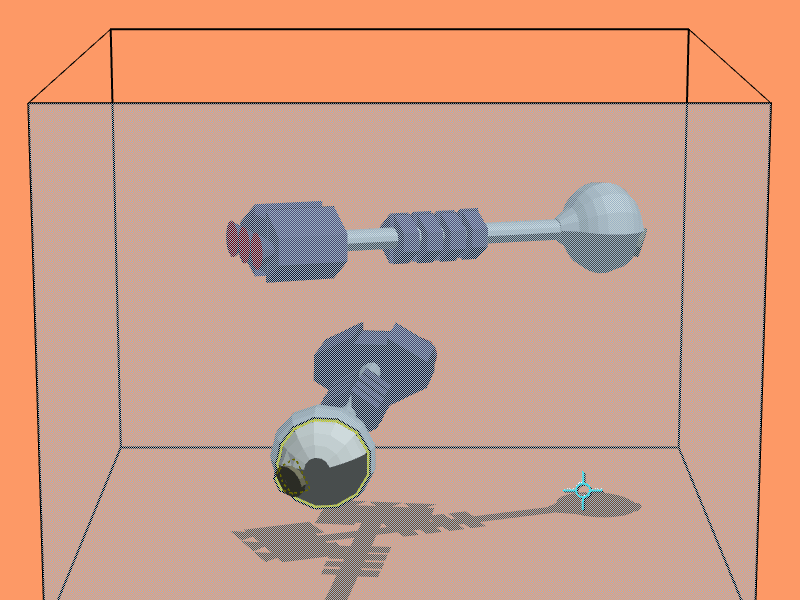

# Cutplane

## ▶ [Try Cutplane in your browser](https://willkessler.github.io/cutplane_web/)

**[willkessler.github.io/cutplane_web](https://willkessler.github.io/cutplane_web/)**: nothing to
install or clone. It runs entirely in the page; press **F** to start working.

[](https://willkessler.github.io/cutplane_web/)

A browser-native rebuild of **Cutplane / 3Form**, the late-1980s SGI 3D modeler built around a
_moving section plane_. You push a plane through the room, and wherever it slices your solids you
see their cross-sections. Vertices, edges and faces are picked and edited where they cross it.

> **Status: M8 (ship).** The animation shows the _Discovery_, modeled in 3Form in April 1991
> and loaded unchanged from its original `disc4.cut`. The cutplane is pushed through it (the
> yellow line is the live section), and a face of the command module is taken hold of through the
> section, pulled out and pushed back home. The rotate tool rolls the lower ship and back. Then
> the drill comes off its pad: pressed on the module it makes a red copy of it, and carried across
> and let go, the copy takes a bite out of the module. Undo puts it back. All of this runs on the
> original CPL scripts in a CPL virtual machine; the cutting is done by manifold-3d and comes back
> as the original's kind of polygon faces. The saw, pencil (in the plane or across a face), union
> tool, magnet, grabber, pan tool, magnifier, group tool and the measure pad all work too, and a
> **?** in the room shows the controls. Models in glTF, OBJ, STL, Open Inventor, VRML and DXF can
> be dropped on the page, the world exports to glTF (it opens in Blender), OBJ and STL, and every
> change is autosaved in the browser with its undo history.
>
> **New here? Read the [user guide](docs/GUIDE.md).** Then the
> [controls](docs/README.md#using-cutplane), the [roadmap](docs/README.md#roadmap) and
> [how it differs from the original](docs/README.md#differences-from-the-original).

## Quick start

Everything installs, builds and tests inside Docker. Nothing needs to be installed on the host
except Docker.

```sh
docker compose up                          # dev server at http://localhost:5173
docker compose run --rm dev pnpm check     # format, lint, typecheck, unit tests, build
docker compose run --rm e2e                # Playwright: Chromium, Firefox, WebKit
docker compose --profile prod up web       # production image at http://localhost:8080
```

## Layout

| Package              | Purpose                                                                       |
| -------------------- | ----------------------------------------------------------------------------- |
| `packages/kernel`    | Half-edge B-rep, Euler operators, sectioning, selection (no DOM, no three.js) |
| `packages/formats`   | `.cut` / `.rsc` / `.dcl` / `.icon` I/O; OBJ, STL and glTF import and export   |
| `packages/booleans`  | manifold-3d adapter, with coplanar face re-merge back into the B-rep          |
| `packages/cpl`       | CPL assembler, virtual machine, disassembler and debugger                     |
| `packages/behaviors` | The world CPL runs in: host API, C routines, the environment's tools          |
| `packages/app`       | three.js renderer, input and full-screen work mode, UI                        |

## Deploying

Every push to `main` builds the static site in the dev image and publishes it to
[GitHub Pages](https://willkessler.github.io/cutplane_web/) ([workflow](.github/workflows/pages.yml)).
`BASE_PATH` sets the path it is served under (`/` by default).

The production image (`docker/Dockerfile`) builds the static site and serves it with Caddy on
`$PORT`. Both [Render](render.yaml) and [Railway](railway.json) configs are included. Point
either service at this repository and it will build from the Dockerfile.

## License

[MIT](LICENSE).
