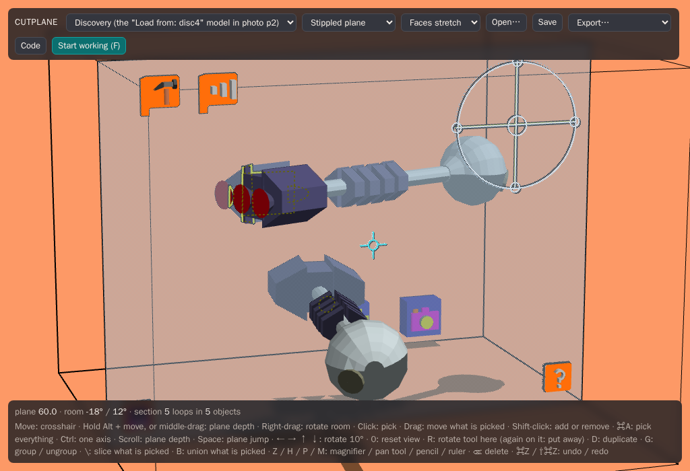
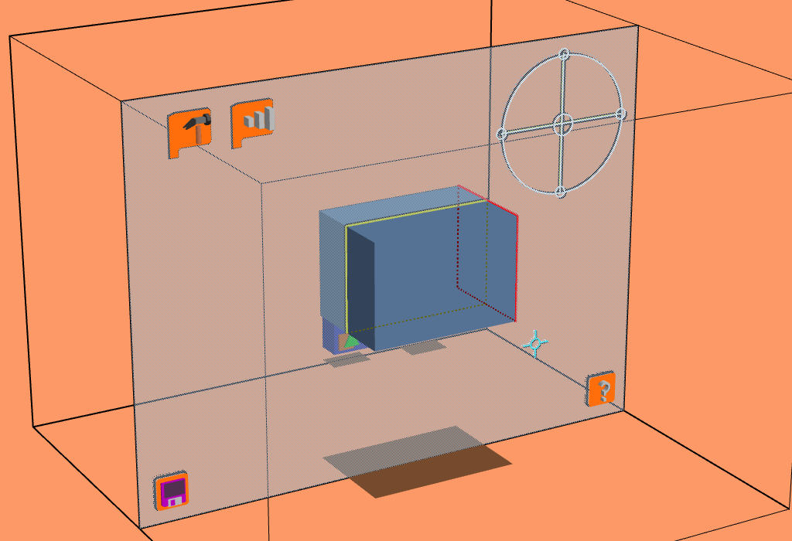
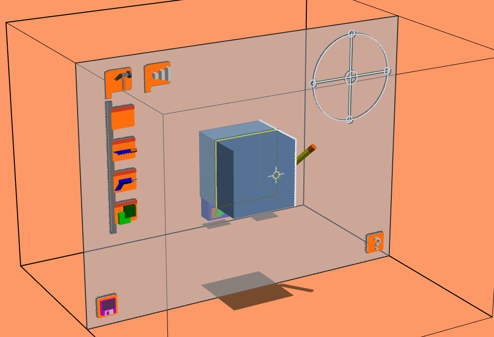
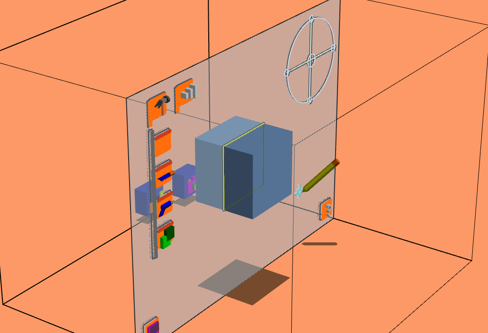
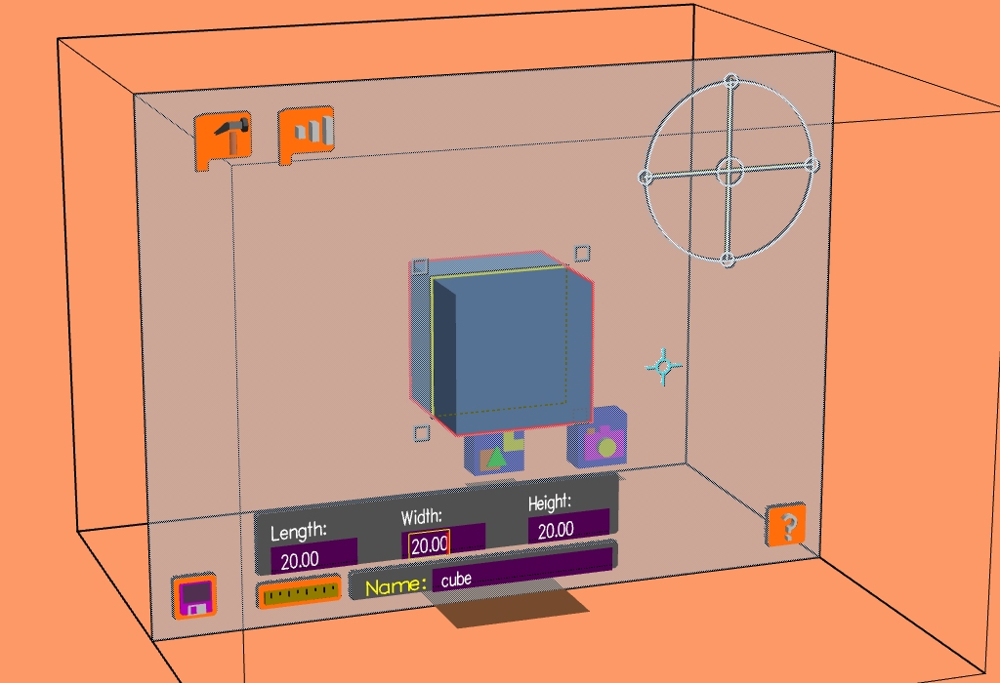
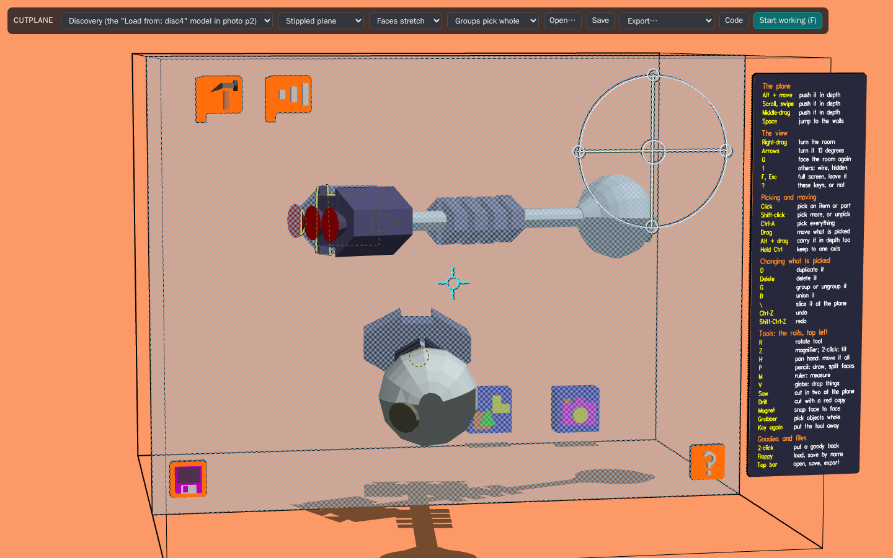

# Cutplane user guide

Cutplane is a 3D modeler you work in through a moving slice. A flat **cutplane** stands across the
room, and wherever it passes through a solid you see the solid's cross-section. You pick, drag and
reshape things where they cross that plane. This guide walks through it from the first click. The
[reference](README.md#using-cutplane) lists every control in full.

Open it at **[willkessler.github.io/cutplane_web](https://willkessler.github.io/cutplane_web/)**.
Nothing to install. It works in Chrome, Edge, Firefox and Safari on a desktop or laptop.

## 1. What you're looking at

- **The room** is the box. Its front wall is open, toward you.
- **The cutplane** is the sheet of fine dots parallel to the front wall. It only ever moves
  forward and back. Whatever lies behind it shows through the dots.
- **The crosshair** (the small circle and cross) always lies in the plane. It is your hand.
- **The section** is the yellow outline where the plane cuts a solid. You pick things through it.
- Around the edges of the plane ride the tools: the **toolbars** top left (orange headpads with a
  hammer and with three bars), the **rotate tool** top right, the **floppy disk** and the **?**
  along the bottom. They move with the plane, so they're always within reach.
- The **?** pad (or the ? key) opens the **keys plate** beside the room: every key and tool, in
  groups (section 9).
- Above the room is the **top bar** (models, plane style, files). It disappears when you start
  working (section 2).
- The first time, the room is turned a little and the keys plate is open. After that, Cutplane
  opens as you left it (section 8).

A trackpad, a two-button mouse and the SGI's three-button mouse all work as they are, with
nothing to set up: hold ⌘ or right-drag to turn the room, hold ⌥ (Option, Alt) or middle-drag to
move the plane. Every held key or button is **spring-loaded**: it lasts only while you hold it.

## 2. Looking around

| To...                   | Do this                                                   |
| ----------------------- | --------------------------------------------------------- |
| move the crosshair      | move the pointer                                          |
| move the plane in depth | hold ⌥ and move, middle-drag, or scroll                   |
| turn the room           | hold ⌘ and move, right-drag, or the arrow keys            |
| face the room straight  | 0                                                         |
| jump to the back wall   | Space (again comes back; the next goes to the front wall) |
| work full screen        | **F**, or _Start working_; Esc leaves                     |

Push the plane slowly through a model and watch the section change. Moving slowly, the plane
**clicks onto the depths of vertices**, so a face or an edge comes to lie exactly in the plane,
ready to take hold of. Move fast and it flies straight through. Hold **Ctrl** to move it slowly
without clicking.

A face **parallel to the plane holds it** for a moment: the plane catches on it and stays until
you've pushed a little further, so it's easy to stop right on the face and take it whole. The top
bar sets how firmly (_Faces stick_, or not at all).

**Work mode** (F) goes full screen and captures the pointer, as the SGI did: nothing flat covers
the room, and the pointer can't run off the edge of the window. Press **?** (the key, or the pad
at the bottom right) any time for the keys plate.

## 3. Picking and moving

Everything is picked **at the crosshair, through the section**. Hovering, what you would pick is
outlined in white with a small yellow box where you'd take hold of it. What is picked turns red.

- Over a **corner** of the section: a vertex, or the edge that pierces the plane there.
- On the **section line**: the face it cuts.
- **Inside** the section: the whole object. An object that belongs to a group is picked with its
  group.

**Groups pick whole or by part** (top bar). With _Groups pick whole_, the first choice, a click
anywhere on a group's part picks the whole group. _Groups pick by part_ is the original: a click
on a grouped object's corner, edge or face picks just that, and only a click inside its section
picks the group.
Use it for imported models: a model file comes in as a group of many thin parts, whose sections
have little inside to click (the rover's wheels, say, and nothing else). Ungroup (**G**) to work
on single faces again.

**Press and drag** to move what is picked. It follows the crosshair in the plane; hold ⌥ while
dragging to carry it in depth too. (A trackpad can't swipe mid-drag: while it's pressed, macOS
sends no scrolling, so ⌥ is the way to carry things in depth there.) **Shift-click** adds to what is picked or takes something away.
**Press on empty space and drag** to draw a **marquee**: a box that picks the objects inside it
(move the plane while dragging for a 3D box). **⌘A** picks everything; **⌫** deletes what is
picked. **⌘Z** undoes, one drag at a time, and **⇧⌘Z** redoes.

Try it: choose **New cube** from the model menu, put the plane through the cube (⌥ and move), and
drag one of its corners out. The faces around the corner stay flat: they split as needed and join
up again when you put the corner back.

**Faces stretch or extrude** (top bar). _Faces stretch_ is the original: drag a face and the faces
around it stretch to follow. With _Faces extrude_, a face pulled outward grows walls of its own,
so the cube above has grown a box out of its right side. Push it back and the walls go.

## 4. Turning and resizing

- **R** brings the **rotate tool** to the crosshair and picks what's there. Slide along one of its
  bars to roll the object over, or turn its outer circle to spin it in the plane. R on its centre
  puts it away.
- A picked object shows the handles of its **scale box**: grey squares where the box's edges
  pierce the plane. Drag one to stretch the object; Ctrl scales it evenly.
- **D** duplicates what is picked, **G** groups it (or ungroups a group), **\\** slices it in two
  at the plane, **B** unions picked objects into one solid.

## 5. Tools

Click the **hammer** headpad (top left) to open its rail, and click a pad to take its tool. A
tool rides on the crosshair; click its pad again, or call up another tool, to put it back.

- **Pencil** (or **P**): press and draw a shape in the plane. Let go and it becomes a solid 50
  deep. Or draw **on a surface**: press on a corner of an object's section, and a white line
  follows the crosshair...

  

  ...press on another corner of the same face, and the face is split along the line. Pull the new
  face out with _Faces extrude_, or paint it.

  

- **Saw**: click on an object to cut it in two at the plane. Taking the saw keeps what is picked:
  pick a whole group (the Discovery, say), take the saw, and a click on it cuts every part at once.
- **Drill**: press on an object to make a red copy of it, the cutter; carry it into another
  object and let go, and the cutter is taken out of it.
- **Union** (two green blocks): carry one object into another and let go, and they become one.

The headpad with **three bars** opens the arranging tools: the **magnifier** (**Z**: drag up to
zoom in, down to zoom out; **double-click** with it and everything is fitted into the room at
once), the **group** tool, the **pan** tool (**H**: drag to move the whole world), the **magnet**
(press on a face of one object, let go on a face of another, and the first lies flush on the
second), the **grabber** (always picks whole objects), the **ruler**, and the **globe**.

- **Group** (three little men): with things picked, click on one of them and they're grouped (on
  one picked group, it's taken apart), as **G** does, and the tool goes back to its pad. Or drag
  a marquee with it: everything the marquee touches, even partly, is grouped at once.
- **Magnet**: take an object by a face and drag. It stays on the crosshair, passing through
  anything. Bring the crosshair to another object's face (on the section line, where it would
  highlight) and that face lights up, with a see-through ghost of what you're dragging snapped
  onto it: the face you took turned flush against it. Let go and the object goes to the ghost.
  Move off and the ghost goes; near another face it shows there instead; let go with no ghost
  and the object stays where it is. The magnet stays in hand until you put it away.
- **Globe** (a little Earth, the last pad, or press **V**): click on an object and it falls to the floor. It
  tumbles, bounces a little and comes to rest as a solid of its shape would, so a car or a rover
  held at a slant lands on its wheels, and a chair on its legs. A group falls whole; click on
  something picked and everything picked falls (things dropped together can land on each
  other). It lands on whatever is under it, the floor or another object, so stacking things is a
  matter of dropping one over another. Only the room's floor is solid, not its walls: something
  bigger than the room falls too. Then the globe goes back to its pad. One ⌘Z lifts it back to
  where it was. You needn't wait for things to settle: click on something while it falls and it
  stops there, picked, to drag where you like; anything else falling carries on as it was. A fall is worked out by
  [Rapier](https://rapier.rs), a physics engine, from each part's _convex hull_ (the part
  shrink-wrapped): the hull's underside is what a solid lying on a floor can touch it with.
- **Gravity always**: **double-click** with the globe and everything falls, and keeps falling
  after every change: nothing stays up unless you're dragging it. With _Groups pick whole_, what
  you pick up **dangles** from where you took hold of it, rather than changing shape. Taken by a
  corner, it hangs from that corner; by an edge, it swings about that edge, which keeps its
  slant; by its inside, it turns until its weight hangs below. Move the crosshair and it swings.
  Let go and it drops; you can take it again in mid-air. ⌘Z still puts things back where they
  were (gravity leaves an undo be).
  Double-click with the globe again to turn it off.

The **toolboxes** stand on the floor at the back (Space takes the plane there). Click one to open
it. The primitives box holds a cube, cylinder, cone, sphere and pyramid: press on one and a copy
comes out, picked, to carry forward into the world. The goodies box holds a camera (section 7), a
light bulb and the colour control (three bars and a paint chip: drag a bar and what is picked takes
the colour, or drag the chip onto a face to paint it). **Double-click** the colour control's base
or the camera's body to put it away: it goes back into its box, which closes.

**1** clears the view. With something picked, the first press draws everything else as grey wire
(the edges of the faces turned towards you), the second puts it out of sight (and out of reach:
it can't be picked or cut), and the third brings it all back. With nothing picked, the first
press draws everything as wire, every edge, back ones too, and the second brings back the
solids.

## 6. Measuring

Take the **ruler** (on the arranging rail, above the globe, or press **M**) and the **measure pad**
comes out, bottom left beside the floppy. Put the ruler away and it goes.

- **Pick an object** and its **length** (front to back), **width** and **height** show above the
  pad, in inches (ten room units to the inch, as the 1991 original had it), with its name.
- **Change a size:** click a field (its text is outlined, ready to replace), type the new size
  and press Return. The object is resized from its lower corner, and one ⌘Z puts it back. Type
  into the name field to rename it.
- **Pick two things** (shift-click the second) to see how far apart they are, overall and along
  x, y and z. Type a new distance and the second one moves.
- **Pick an edge** to see its length.
- **Drag out a marquee** and its size shows as it grows.

## 7. The camera

The camera gives you a second point of view.

1. **Take it out.** Space takes the plane to the toolboxes; click the goodies box (the one with the
   camera on it), then drag the magenta camera out and carry it forward (⌥ and move).
2. **Turn its view on.** Click the camera. A small screen comes up in the room above it, with a
   thin black border, showing what the lens sees, live as you carry the camera.
3. **Aim it.** It comes out of its box looking out of the room, at you. Put the plane through the
   lens (the grey cylinder at its front) and drag the lens: the camera turns to follow. To turn
   it round to face the world, hold the lens and take the plane back past the camera (⌥ and move).

Click the camera again to put the view away.

## 8. Files

- **Open…** (top bar), or drop files anywhere on the page:
  - a **`.cut`** world from 3Form or Cutplane replaces the world;
  - **models** are added to it: glTF (`.glb`, `.gltf`), OBJ (with its `.mtl`), STL, and the SGI
    era's Open Inventor (`.iv`, text or binary), VRML (`.wrl`) and DXF, gzipped or not
    (`.iv.gz`). A file comes in as one group; **G** takes it apart. Models are made into solids on
    the way in, and scaled to fit the room if need be.
  - A big file takes a few seconds: a **ring turns in the room** while it's read, filling as it
    goes. **Esc** stops it. A model of more than 400,000 faces is simplified to about that many,
    so the room stays quick to work in; add `?faces=all` to the page's
    address to keep every face.
    Free models to try: [Poly Pizza](https://poly.pizza/) (glTF, CC0 and CC-BY) and
    [Sketchfab](https://sketchfab.com/) (filter by downloadable).
- **Save** writes the world as a `.cut` file, and keeps a copy in the browser (listed in the model
  menu). The **floppy** pad in the room does the same by name: click it, click _Save to:_ or
  _Load from:_, type a name and press Return.
- **Export…** writes **glTF** (`.glb`, which opens in Blender: _File → Import → glTF 2.0_), **OBJ**
  or **STL** (for printing).
- **Everything is autosaved** in this browser as you go, undo history and all. Close the tab and
  come back, and the world is as you left it; undo still works. Choosing a model from the menu
  starts that model afresh, so Save what you want to keep. (It's kept once the mouse and keys
  have been left alone for five seconds, or as you leave the page. With a very big model, the
  undo history kept is only its last few steps.)
- **So is the room.** The plane and crosshair, the way the room is turned, which rails are open,
  where the rotate tool is, the toolboxes, the goodies out in the room, the keys plate and the
  top bar's choices all come back as they were.

## 9. Help in the room

Press **?**, or click the **?** pad (bottom right), for the **keys plate**: every key and tool, and
what each does, in groups (the plane, the view, picking and moving, changing what is picked, the
tools, goodies and files). It hangs off the plane's right side, just outside the room, and moves
with the plane; turn the room far round and you see it edge on. Press ? or click the pad again to
put it away. A window narrower than a usual laptop screen cuts off its right side.

## 10. If something doesn't work

- **Nothing happens when I click.** The crosshair must be on the section: put the plane through
  the object first (⌥ and move, or scroll).
- **I can't pick an imported model.** Its section must close. Most models are made solid on the
  way in; one that still shows an open section is picked from inside any part of it.
- **Keys type into a field.** A field on a plate is listening: press Return or Esc, or click
  elsewhere.
- **The plane won't stop where I want it.** Hold Ctrl for slow, unsnapped moves.
- **I lost my work.** Choose _Unsaved changes_ at the top of the model menu.
