# Cutplane documentation

**New to Cutplane? Start with the [user guide](GUIDE.md).** This page is the reference: the
roadmap, every control, how Cutplane differs from the 1991 original, and notes for developers.
Screenshots go in `docs/images/`.

The brief this rebuild began from, written by Cutplane's authors, Will Kessler and Larry Edwards,
is [REBUILD_BRIEF_BY_AUTHORS.md](REBUILD_BRIEF_BY_AUTHORS.md). Later waves of requests are kept
beside it, by date ([ENHANCEMENTS_10_17_26.md](ENHANCEMENTS_10_17_26.md)).

## Roadmap

| Milestone | Scope                                                                                                                                                                                                                                                                                                                                                                                                                                                                                                                                                                                                                                                                                                                                                                                                                                                                                                                                                                                                                  |
| --------- | ---------------------------------------------------------------------------------------------------------------------------------------------------------------------------------------------------------------------------------------------------------------------------------------------------------------------------------------------------------------------------------------------------------------------------------------------------------------------------------------------------------------------------------------------------------------------------------------------------------------------------------------------------------------------------------------------------------------------------------------------------------------------------------------------------------------------------------------------------------------------------------------------------------------------------------------------------------------------------------------------------------------------- |
| **M0** ✅ | Scaffold: workspace, Docker dev/prod images, tests, CI                                                                                                                                                                                                                                                                                                                                                                                                                                                                                                                                                                                                                                                                                                                                                                                                                                                                                                                                                                 |
| **M1** ✅ | Kernel and `.cut` I/O: half-edge B-rep, Euler operators, validation                                                                                                                                                                                                                                                                                                                                                                                                                                                                                                                                                                                                                                                                                                                                                                                                                                                                                                                                                    |
| **M2** ✅ | Room, plane, section and full-screen work mode                                                                                                                                                                                                                                                                                                                                                                                                                                                                                                                                                                                                                                                                                                                                                                                                                                                                                                                                                                         |
| **M3** ✅ | Direct manipulation: pick, drag, constrain, carry, marquee, undo                                                                                                                                                                                                                                                                                                                                                                                                                                                                                                                                                                                                                                                                                                                                                                                                                                                                                                                                                       |
| **M4** ✅ | Rotate tool, duplicate, delete, scale boxes, colour                                                                                                                                                                                                                                                                                                                                                                                                                                                                                                                                                                                                                                                                                                                                                                                                                                                                                                                                                                    |
| **M5** ✅ | CPL VM and environment: code stored in objects, live editing                                                                                                                                                                                                                                                                                                                                                                                                                                                                                                                                                                                                                                                                                                                                                                                                                                                                                                                                                           |
| **M6** ✅ | Modeling operations: slice, booleans, drill, pencil, arrange tools                                                                                                                                                                                                                                                                                                                                                                                                                                                                                                                                                                                                                                                                                                                                                                                                                                                                                                                                                     |
| **M7** ✅ | Formats: OBJ, STL, glTF, drag and drop, autosave                                                                                                                                                                                                                                                                                                                                                                                                                                                                                                                                                                                                                                                                                                                                                                                                                                                                                                                                                                       |
| **M8** 🚧 | Ship: user guide, help plate, measure pad, the camera's view, big and binary Inventor files, gravity, live on GitHub Pages; Oct 17 wave: fit to room, the 1 key's wire views, gravity always with dangling, double-click to put goodies away; Oct 18: the room as you left it, a turned first view, Ctrl scales evenly by a scale box's handle, a picked object's faces stay pickable, the plane sticks to parallel faces, the camera's view on a screen in the room (no window; fly-overs to come back as a camera path), a tool in hand outlined only where it's hidden, the 1 key's wire darker and (nothing picked) one press to every edge and one back; then: the magnet shows its snap with a ghost, falling things can be taken hold of, the keys plate behind ? (in groups, no status bar), a new hand; Oct 23: big meshes quick (the plane cuts only what it meets, stand-ins while moving or turning, an outer outline), drop a folder; Oct 24: rounder primitives, faces in the plane scaled by a flat box |
| M9        | Acceptance: load and rebuild the stapler, fan and Discovery                                                                                                                                                                                                                                                                                                                                                                                                                                                                                                                                                                                                                                                                                                                                                                                                                                                                                                                                                            |
| M10       | Language evolution (optional)                                                                                                                                                                                                                                                                                                                                                                                                                                                                                                                                                                                                                                                                                                                                                                                                                                                                                                                                                                                          |

## Using Cutplane

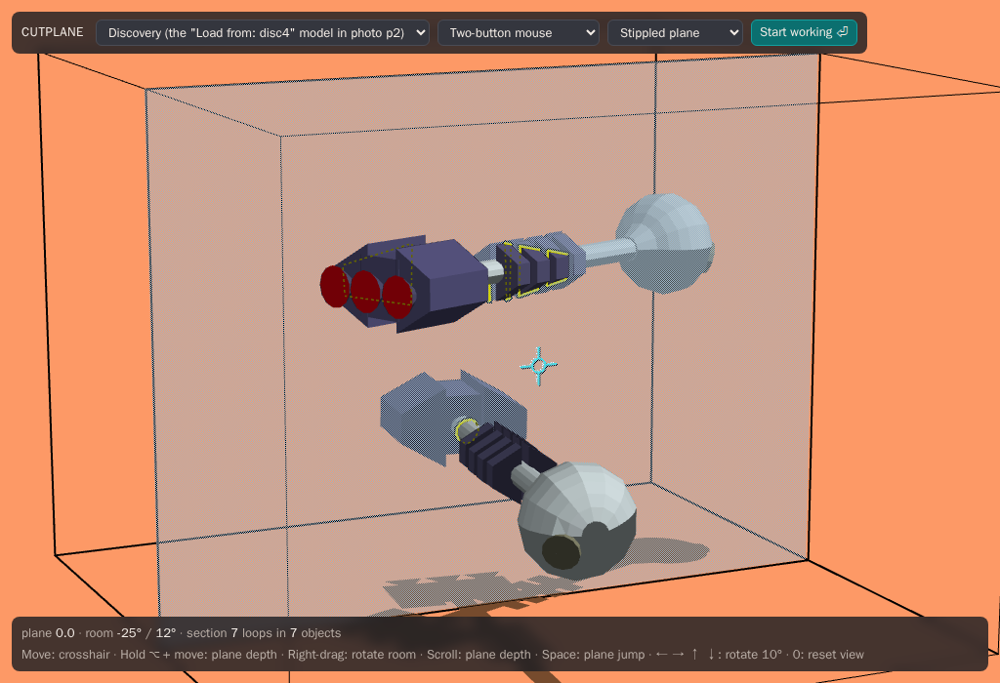

The room is a box in front of you. The **cutplane** is always parallel to its front wall and
moves only in depth, and the **crosshair** always lies in the plane. Wherever the plane slices a
solid you see its **section**: medium yellow where the cut surface faces you, edged in black so it
reads over any colour, dotted where geometry in front of the plane hides it, and bright yellow
for edges lying exactly in the plane. Whatever is behind the plane shows through its stipple, so
"behind" is visible at a glance. Shadows fall straight down onto the floor.

As the plane moves slowly it **clicks onto vertex depths**: a small move that would carry it past
a vertex lands exactly on it, and the next move carries on. Fast moves fly straight through, so a
dense model never slows you down (the original's `snap_plane_to_nearestpt`). That is how faces and
edges come to lie in the plane, ready to grab. Holding **Ctrl** moves the plane slowly with no
snapping.

The depths of **faces parallel to the plane are sticky** (new): they catch moves of up to the
stick distance, not just slow ones, and hold the plane until it has been pushed that far again,
either way. Then it carries on by what was pushed past the hold. The top bar's choice sets the
distance: none, 5 (the original's `Freedomforplane`), 15 (the default) or 30 room units. This is
the original's `do_sticking`, which nothing there called.

### Controls

A trackpad, a two-button mouse and a three-button mouse all work with the same bindings, with
nothing to choose (a browser can't tell them apart, and none of their bindings conflict). Every
mode is **spring-loaded**: it lasts only while you hold the key or button.

| Action          | Trackpad              | Mouse                              |
| --------------- | --------------------- | ---------------------------------- |
| Move crosshair  | move                  | move                               |
| Plane depth     | hold ⌥ + move, scroll | middle-drag, hold ⌥ + move, wheel  |
| Rotate the room | hold ⌘ + move         | right-drag (or hold ⌘ + move)      |
| Pick, drag      | click, press and drag | left                               |
| Carry in depth  | drag, then hold ⌥     | left + middle, or drag then hold ⌥ |
| Add or remove   | shift-click           | shift-click                        |
| Pick everything | ⌘A (Ctrl+A off a Mac) | ⌘A (Ctrl+A off a Mac)              |
| One axis        | hold Ctrl             | hold Ctrl                          |

A scroll is told apart per event: a wheel's notches move the plane straight in depth, a
trackpad's swipe follows the plane's direction on screen.

| Key     | Command                                                                                                      |
| ------- | ------------------------------------------------------------------------------------------------------------ |
| Space   | Plane jump: glides to the back wall and back again; the next to the front wall and back                      |
| ← → ↑ ↓ | Rotate the room 10° (±90° side to side, 0–90° from above)                                                    |
| 0       | Reset the view                                                                                               |
| F       | Start or stop working (full screen, pointer captured)                                                        |
| Esc     | Put the tool in hand away (in full screen, Esc leaves it)                                                    |
| R       | Rotate tool to the crosshair (on its centre: put it away)                                                    |
| D       | Duplicate what is picked                                                                                     |
| G       | Group what is picked (on one group: ungroup it)                                                              |
| \\      | Slice what is picked at the plane                                                                            |
| B       | Union what is picked into one object                                                                         |
| Z, H, P | The magnifier, the pan tool, the pencil, to the crosshair                                                    |
| M       | The ruler: the measure pad comes out (again: put it away)                                                    |
| V       | The globe (gravity) to the crosshair                                                                         |
| 1       | What isn't picked as wire, then out of sight, then back (nothing picked: all as wire, every edge, then back) |
| ⌫       | Delete what is picked                                                                                        |
| ⌘Z, ⇧⌘Z | Undo, redo (Ctrl+Z, Ctrl+Shift+Z or Ctrl+Y elsewhere)                                                        |

Dragging the plane follows the plane on screen: you push it the way it visibly travels as it goes
deeper. Facing the room, that is up the screen; with the room turned 90°, it is sideways. Two-finger
swipes on a trackpad follow it the same way. A mouse wheel rolled up (away from you) always sends
it deeper, on a Mac too, where a wheel is told apart from a trackpad's swipe.

### Editing

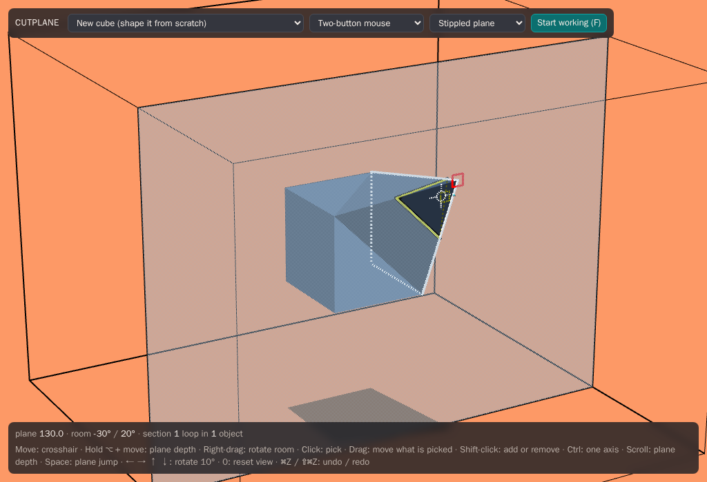

Everything is picked and moved through the section, at the crosshair. What the crosshair would
pick is outlined in white, with a yellow pick box at the point it would take hold of; what is
picked is red. In order of priority, within a 10-unit box around the crosshair:

1. a **vertex** lying in the plane;
2. an **edge**: one lying in the plane (anywhere along it), or one piercing it (at the
   piercing point, a corner of the section);
3. a **face**, through its section line;
4. a **face lying in the plane**, from anywhere inside it;
5. the whole **object**, from inside its section. Objects marked `Lockedgeometry` are always
   picked whole, and an object is always picked with the group it belongs to.

**Groups pick whole or by part**, as chosen in the toolbar. _Groups pick by part_ is the
original's way, as above. With _Groups pick whole_ (new, and the first choice), any pick on a part of a group in the
world (its vertex, edge or face) picks the group: an imported model is a group of many thin
parts whose sections have little inside to click.

**Press and drag** to move what is picked: a 5-unit dead zone first, so a click never nudges
anything, then it follows the crosshair exactly. Everything moves rigidly, in the plane. **Moving
the plane while still holding** carries it in depth too, and so does the plane jump (Space).
Faces the motion would bend are split first, so every face stays flat: a convex face loses just
the triangle at the moving corner, anything else is triangulated. The pieces still act as one
face (they highlight and drag together), and **on release, pieces that are flat again merge
back**. Pull a corner out and push it back, and the cube is a cube again.

**Faces stretch or extrude**, as chosen in the toolbar. _Faces stretch_ is the original's way:
a dragged face's vertices move, and the faces around it stretch to follow. _Faces extrude_ is new,
to try out: a flat face pulled outward grows four (or more) walls of its own, so the faces
around it keep their shape and the edges where the face was stay in the model. Pulled back to
where it started, the walls go again; a face pushed inward stretches, as in the original.

A highlighted edge on the far side of its object, its faces all turned away from you, is drawn
dimmer than one on the near side, so the two can't be confused.

- **⌘A** (Ctrl+A) picks every object in the world; ⌫ then clears it.
- **Shift-click** adds to what is picked, or takes a picked feature or object away. Pressing on
  something already picked keeps the rest, so several things can be dragged together.
- **Press on empty space** and drag out a **marquee**: a box in the plane, or a 3D box if you move
  the plane while dragging. It picks the objects inside it (shift adds to the picks). A plain
  click on empty space drops all picks.
- **Ctrl** locks the crosshair, and so the drag, to one axis: it holds still for the first 5
  units and then follows only the axis you pushed along most.
- **Undo and redo** (⌘Z / ⇧⌘Z) go back and forth one drag at a time. A drag that would leave a
  solid broken (an edge squashed to nothing, a face folded flat) is put back on release.
- **New cube** in the model menu starts from a plain cube, to shape from scratch.

### Tools

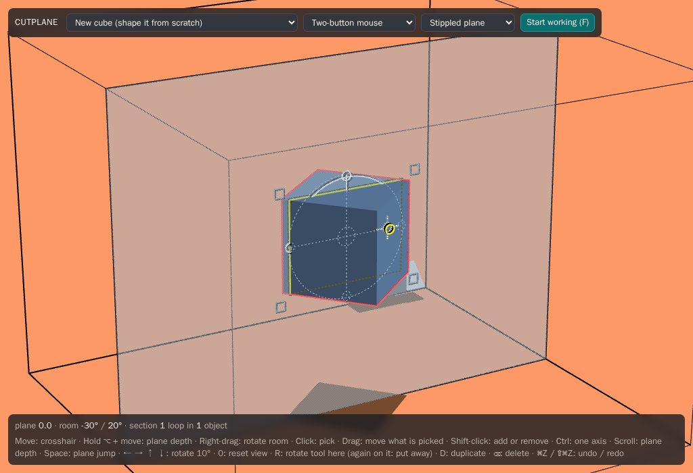

Like everything else, the tools stand in the room and are used through the plane.

- **The rotate tool** always lies in the cutplane, parked in the upper right corner: a centre
  ring, two crossbars with a bauble at each end, and a dial circle. **R** brings it to the
  crosshair and picks what is there on its own. Over a vertex, edge or face it lines up with
  the feature: along an edge lying in the plane, across a face's section line, or, on an edge
  piercing the plane, ready to spin about that edge. **R** on the tool's centre parks it again,
  and the centre can also be dragged and dropped onto a feature.
  - **Slide along a bar** to roll what is picked about the axis in the plane across the bar,
    through the centre: 1° per unit. The crosshair stays on the bar.
  - **Off the end of a bar**, or from a **bauble**, the drag turns the dial: the crosshair rides
    the circle and what is picked spins about the plane's normal (or about the piercing edge),
    the bars turning with it. It pauses briefly at horizontal.
  - **Set on a face's section line**, rolling stops briefly when the face stands straight across
    the plane, and within 5° of lying in the plane it **snaps the face exactly into the plane**;
    the rotation ends there and everything is let go.
  - Rotation always turns whole objects (with their group).
- **Scale boxes.** A picked object shows the handles of a box 20 units outside it: grey squares
  where the box's edges pierce the plane, white ones at corners the plane is near. Drag an edge
  handle to stretch the object across that edge, away from the opposite one; move the plane
  while holding it to slide the handle along its edge to a corner. Drag a corner to scale about
  the opposite corner, each axis on its own (carrying it in depth scales in depth). **Ctrl**
  scales evenly about the middle.
  - Faces picked in the plane get a flat box of their own, whose corners scale the faces in
    the plane (Ctrl: evenly, about their middle). Faces beside them that would bend are split,
    and merge back where they come out flat.
- **D** duplicates what is picked: each picked thing's whole object, 100 units right and up, and
  the copies are picked. **⌫** deletes it: whole objects, or single vertices, edges and faces.
  Deleting a vertex cuts it off, the faces around it becoming one face across its neighbours;
  an edge between two faces lying flat merges them, any other edge goes with both its ends; a
  face goes with all its corners. A delete that would leave the solid broken or flat is refused.
- **The colour control** lives in the goodies box (see below): three bars, red, green and blue,
  on a base, and a white paint chip. Drag a bar's top up or down and what is picked takes the
  mixed colour as you go. Drag the chip and a copy comes away with the crosshair; carry it to a
  face or an object (move the plane with it) and let go to paint it there. A face painted on its
  own keeps its colour when its object is recoloured. Drag the **base** to bring the whole
  control along, up beside what you are colouring (move the plane while holding it to carry it
  forward).

All of these can be undone.

### The environment

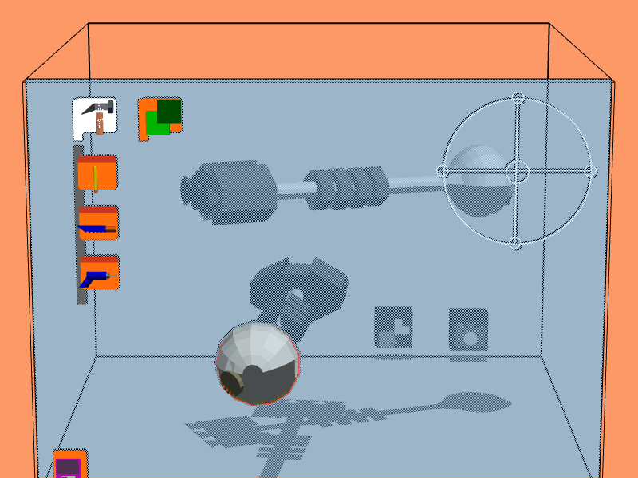

The room is laid out as in the 3Form photos. Everything in it runs on the original CPL scripts.

- **Toolbars** ride in the plane, top left: a **headpad** with its icon (the hammer for the tools
  that hammer out changes to objects; three bars in a row for the tools that look at and arrange
  them), and under it a rail of **toolpads**, each with its tool's picture.
  Click a headpad to open or close its rail. The arranging rail's headpad shows three bars in a
  row; its pads hold the magnifier, group tool, pan tool, magnet, grabber, ruler and globe.
  - Click a toolpad and its tool comes off it and rides on the crosshair, just in front of the
    plane. Click the pad again to put the tool back. Click another pad (or call up a tool by
    key) and the tool you hold goes back to its own pad.
  - Drag a pad by its handle (the strip along its top) to pull it off the rail. Let it go
    anywhere to leave it floating, on another rail to hang it there, or on a headpad to drop it in.
  - The tools on the pads do their work: see [Modeling](#modeling) below.
- **Toolboxes** stand on the floor by the back wall, bottom right; Space takes the plane there.
  Click one to open it, and what it holds stacks up above it.
  - **Primitives box.** Pick a primitive (cube, cylinder, cone, sphere, pyramid) and a copy is
    stamped into the world, picked, ready to drag forward. The box closes again.
  - **Goodies box.** It holds the **camera**, the **light bulb** and the **colour control**. Drag
    one out to use it; drop it on the box to put it back.
    - The bulb lights the room in its colour from wherever it is. Paint it with the colour
      control to change the light.
    - Click the camera and its view comes up on a small screen with a thin black border,
      standing in the room above the camera like the plates do: what its lens sees (the world
      and the room, without the plane or the tools), live as you carry it. Put the plane
      through its lens and drag the lens to aim the camera: it turns about its middle to follow
      the crosshair (`lens.cpl`). It comes out of its box looking out of the room, at you, so
      aim it first: hold the lens and take the plane back past the camera to turn it round.
      Click the camera again to put the view away.
    - Dropped back on its box, the bulb goes out and the camera's view goes away.
- **The storage pad** (the floppy disk, bottom left in the plane) opens the **Load / Save
  plate**. Click a field and type: the keys go to the field (Backspace, ← →; Esc puts the old
  text back), not to the commands.
  - Return on **Save to:** keeps the world in this browser under that name.
  - Return on **Load from:** brings in a world you saved, or a bundled sample (`disc4`,
    `stapler`...).
  - In any field, the first key you type replaces what it said (the text is outlined until
    then); Backspace clears it; an arrow key first lets you edit it in place.
- **The ? pad** (bottom right, in the plane), or the **?** key, opens the **keys plate**: every
  key and tool, in the room's own lettering. Click ? again to put it away.
- **The measure pad** comes out with the **ruler** (the last pad on the arranging rail, or
  **M**), bottom left beside the floppy, and goes when the ruler is put away. While it's out:
  - pick an object and the cube plate above it shows its **length** (front to back), **width**
    and **height**, in inches (10 room units to the inch, as the original had it), and the name
    plate its name. Type a size and Return, and the object is resized to it from its low corner
    (one undo); type a name and Return to rename it;
  - pick two things (shift-click the second) and the distance plate shows how far the second is
    from the first, overall and along x, y and z. Type a distance and Return to move the second;
  - pick an edge and the length plate shows how long it is;
  - drag out a marquee and the cube plate shows its size as it grows, its depth too if you move
    the plane while dragging.

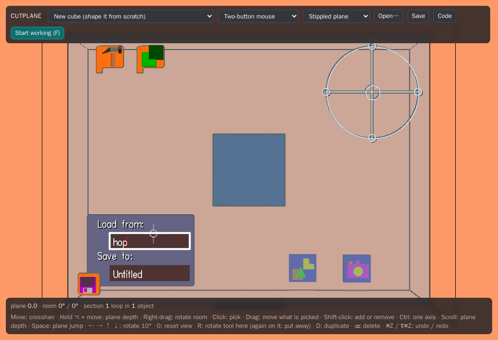

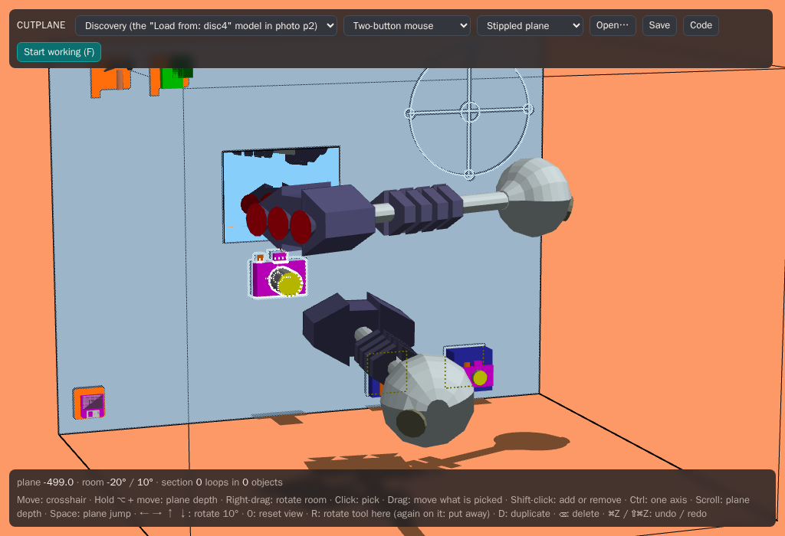

### Modeling

Take a tool off its pad (it rides on the crosshair) and use it through the plane. A tool goes
back to its pad by itself once it has done its work, or click its pad. Everything here is one
undo away.

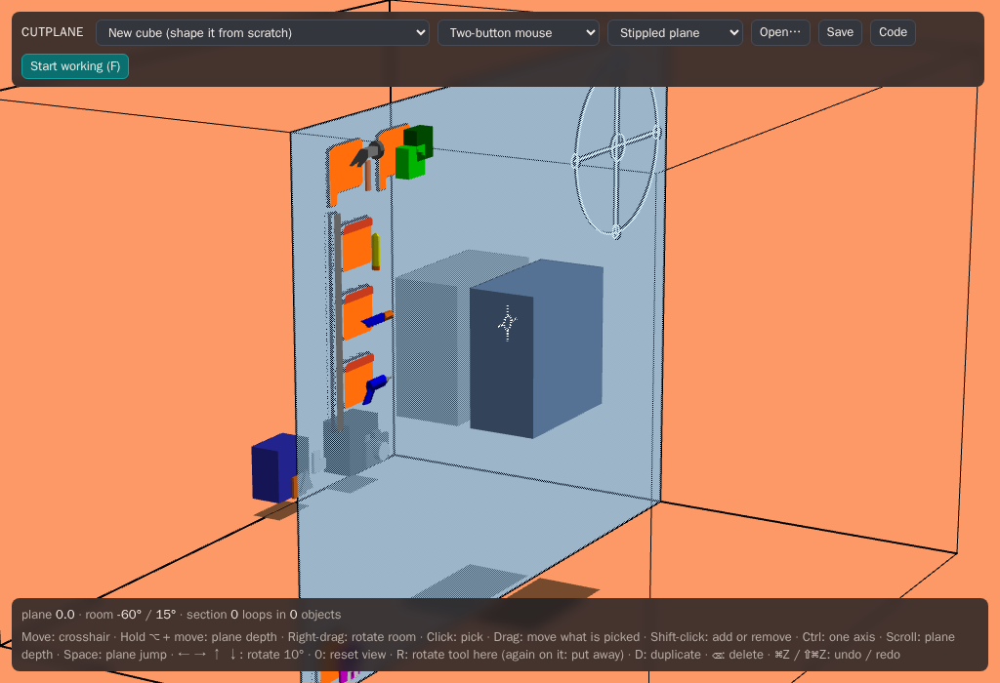

- **Saw.** Click on something with it and it's cut in two at the plane. Each piece becomes an
  object of its own, pulled 10 apart either side of the plane so the cut shows, even when what
  was cut is a part of a group (the Discovery's module, say). Taking the saw keeps what is
  picked, and a click on something picked cuts all of it: pick the whole Discovery, take the saw,
  click on it, and every part is cut. **\\** does the same to what is picked, without the saw.
- **Drill.** Press on an object with it: a red copy of it, the **cutter**, comes away with the
  drill. Carry it into another object (move the plane to carry it in depth) and let go, and the
  cutter is taken out of that object. A cut that leaves pieces apart makes each piece an object.
  The hole's faces are the object's colour, as in the original, not the cutter's. Pressed and
  let go on the same object, the drill does nothing.
- **Pencil.** Press and draw in the plane. Let go and the stroke is closed with a straight line
  back to where it started, and becomes a solid 50 deep, straddling the plane. A stroke that
  crosses itself keeps the largest region it encloses. Only a scrap too small to be a face comes
  to nothing.
  - **On a surface:** press on a vertex or edge where the plane cuts an object (a corner of its
    section, or an edge lying in the plane). A white line follows the crosshair. Press on another
    vertex or edge of the same face and the face is split in two along the line, ready to pull
    out (with _Faces extrude_) or recolour. Press anywhere else to give it up. A line between
    points with no face in common, or one that would leave the face, draws nothing.
- **Magnet.** Press on a face of one object (where the plane cuts it: its outline in the plane)
  and let go on a face of another. The first object turns and moves so its face lies flush on
  the second's, facing it. An edge snaps to an edge the same way. Pressing inside an object, not
  on its outline, does nothing, as in the original. New: taken by a face, it shows where it
  will snap. What it drags stays on the crosshair where it was taken, passing through anything.
  The face of another object under the crosshair (through the section, as a face is highlighted
  to be picked) is highlighted, and a ghost of what is dragged (drawn faintly, 15% opaque, its
  edges light grey) shows it there: the face taken turned flush onto it, the point taken on the
  point highlighted. Move off and the ghost goes; near another face it shows there. Let go with a
  ghost showing and what was dragged goes to it; with none, it stays where it is let go. Either
  way it is let go of (unpicked), and the magnet stays in hand: the original sent it back to a
  pad after a snap.
- **Union** (the two green blocks, on the tools' rail). The drill's twin: press on an object
  with it and the object itself comes away with the tool. Carry it into another and let go, and
  the two become one solid, each part keeping its colours. Let go over nothing and it's just put
  down where it is. One undo parts them, the carried one back where it was picked up.
- **Grabber** (a claw holding a green block). Picks whole objects, even where a plain click
  would take a face or an edge.
- **Pan tool** (or **H**; a pink hand). Drag on empty space to move the whole world with the
  crosshair.
- **Magnifier** (or **Z**). Drag up to zoom the world in about the crosshair, down to zoom out:
  1% per unit. New: a double click with it fits everything into the room at once (scaled to
  0.9 of the room at most, a 10% margin, in its middle; one undo).
- **Group** (**G**, or the group tool: the three little men). With several things picked, G puts
  them under a new group, which is then picked and drags as one. G with one group picked takes it
  apart again. With the group tool in hand, a click on what is picked does the same, and the tool
  goes back to its pad; a click on anything else picks as usual. A marquee dragged with it groups
  at once everything it takes in, even partly, and the tool stays in hand.
- **Union what is picked** (**B**). With several objects picked (shift-click to add), B joins
  them into one solid, the first picked; each part keeps its colours. The drill is the way to
  subtract. (Group, G, is the other way to put parts together: they stay separate solids under
  one object, as the Discovery is built.)
- **Pencil** (or **P**) comes to the crosshair, as the magnifier does with Z.
- **Globe** (a little Earth, on the arranging rail, or **V**). Click on something with it and it falls to
  the floor, tumbling and bouncing a little, and comes to rest as a solid of its shape would: a
  car or a rover held at a slant lands on its wheels. A group falls whole; on something picked,
  everything picked falls, together (they can land on each other). It lands on what is under it,
  the floor or another object: drop one thing over another to stack them. Only the floor of the
  room is solid, not its walls (things may be bigger than the room). One undo lifts it back.
  New: what is falling can be taken hold of. A press anywhere stops every fall where it has got
  to (the globe in hand aside); what the press picks is then the user's to drag, and the rest
  fall on as they were going, at the same speed and spin.
  - **Gravity always:** a double click with the globe, and everything falls, after every change
    from then on: nothing stays up unless it's being dragged. With _Groups pick whole_ any object
    is picked whole, and once dragged it **dangles** from where it was taken: from a corner (or
    from inside, or a face) it swings freely about that point until its weight hangs below it;
    from an edge it swings about the edge alone, which keeps its slant. Moving the crosshair
    swings it. Let go and it drops. Undo and redo are left be. Another double click turns it off.

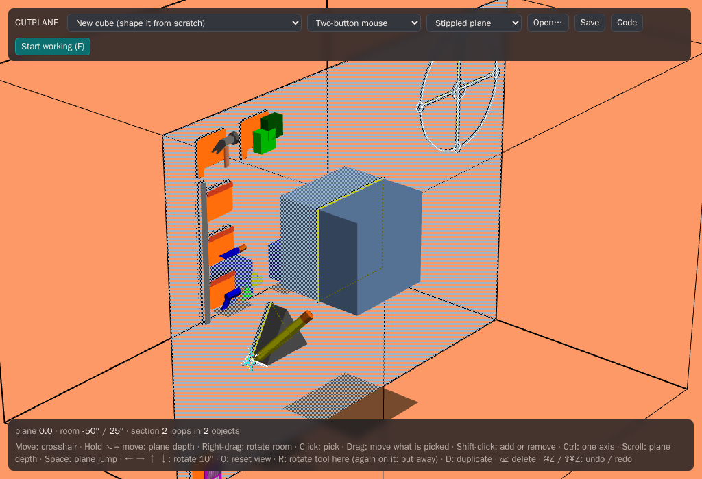

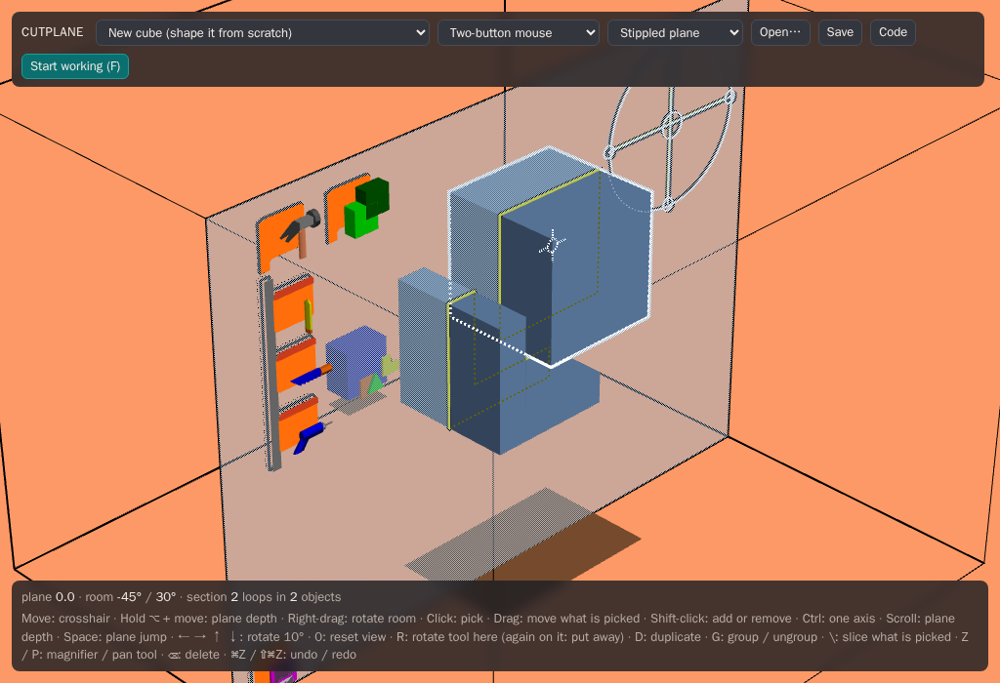

### Code

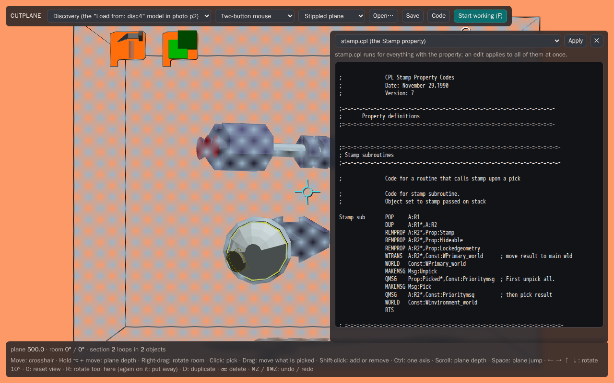

Behaviour lives in CPL, the original's own scripting language, and the app runs the original
scripts. **Code**, in the toolbar, opens the editor (outside work mode only, so nothing flat
covers the room while you work).

- Choose a **property file** (`stamp.cpl`, `toolbox.cpl`, `paint.cpl` and so on) to see the code
  that runs for everything with that property. Choose **What is picked** to see the picked
  thing's name, its properties and its own private code.
- Edit it and press **Apply** (⌘↵ / Ctrl+↵). The world runs the new code from the next frame,
  with nothing restarted: change `stamp.cpl` and the next stamp behaves differently. A broken edit
  is refused, its errors listed, and the old code keeps running.
- **Save** writes the world as a `.cut` file, and each object's private code goes into the file
  with it; **Open…** reads it back, code and all (see [Files](#files)).

### Files

- **Save** writes the world as a `.cut` file (through the browser's file dialog where it has one,
  else as a download). It also keeps a copy in this browser: the model menu lists it under _Saved
  in this browser_ (with what the storage pad's _Save to:_ kept), and choosing it brings it back.
- **Open…**, or **dropping files anywhere on the page**:
  - a `.cut` world (or a `.rsc` or `.icon`) becomes the world being edited;
  - **OBJ, STL and glTF** models (`.obj`, `.stl`, `.glb`, `.gltf`) are **added** to the world, as
    one step that undo takes back out. Drop an OBJ's `.mtl`, or a `.gltf`'s `.bin`, along with it.
  - So are the **SGI era's formats**: **Open Inventor** (`.iv`, ASCII or binary), **VRML 1.0
    and 2.0** (`.wrl`), and **DXF** (`.dxf`: polyface and
    polygon meshes, 3DFACEs, blocks placed by INSERT, an object per layer in AutoCAD's colours,
    z up). A face set's own points, colours and texture coordinates (`vertexProperty`) are
    read, and a `Texture2` (an SGI `.rgb`, a `.png` or `.jpg` dropped with it) colours its
    faces. A terrain made with Z up (an open sheet of a thousand faces or more, nearly all facing
    along Z, as JPL's Mars meshes are) is laid flat and stood on a slab: its outer edge taken
    straight down to a flat bottom. Inventor's face sets, triangle strips, cubes, spheres, cylinders and cones come in
    under their transforms and materials, and each Separator holding several shapes is a group.
    Face sets one after another in a Separator (a model of thousands of parts, each its own
    material, as the Mars rover is) come in as one object, coloured face by face.
  - **Gzipped** files (`.iv.gz`, `.wrz`, `.obj.gz`...) are read as they are.
  - **Big files** are read in the background (a worker), so the room keeps drawing: a **ring
    turns in the room** while it's read, its arc filling as it goes, the file's name under it.
    **Esc** stops the read. A file of more than **400,000 faces** is simplified to about that
    many (meshoptimizer's simplifier, each colour on its own, its borders kept), since every face
    is drawn, cut by the plane and kept in the undo history.
    `?faces=all` keeps every face, `?faces=N` sets another budget.
  - Triangles that lie in one plane come back as one face, holes and all, so an imported box
    has six faces to grab, not twelve triangles.
  - **Colours** come from the materials: their colour, times the texture under each triangle
    (most Poly Pizza and Sketchfab models colour themselves with a texture), times any vertex
    colours. A texture's colours are rounded a little so flat faces still join.
  - **Surfaces are made solids.** Many models aren't solids: a car's glass is single sheets and
    its wheels are open on the inside. Cutplane picks a whole object from inside its section,
    which only closes round a solid, so on the way in, slits where one triangle's corner sits on
    another's edge are stitched shut, and every hole left gets a face of its own (one polygon if
    it's flat, else triangles). A lone sheet becomes a thin solid. Where three pieces meet at one edge, it can't be closed, and the section
    there stays open.
  - **One file, one group.** A file with several parts (a car's body, glass and wheels) comes in
    as a group named after the file, so it moves as one. **G** ungroups it.
  - A room unit is a millimetre. A model that doesn't fit the room (a building), or takes up less
    than a quarter of it (one in metres, a 160-unit fish), is scaled to fill most of it and set in
    the middle. One that fits and isn't small stays where it is.
  - A file of only lines (a mesh drawn as its edges, as SGI's IVREAD wrote VRML) has its closed
    lines read as faces. A face drawn twice is kept once.
  - A glTF node with no mesh that holds others comes in as a group, as the group tool would make
    it: pick one part and you pick the group.
- **Export…** writes the world's objects as:
  - **glTF binary (`.glb`)**: the world's tree as nodes (groups stay groups), in metres, flat
    shaded, a material per colour. It opens in Blender (checked with Blender 4.3) and passes the
    Khronos glTF validator.
  - **Wavefront OBJ**: an `o` per object, polygon faces (a face with a hole goes as triangles),
    colours named `color_rrggbb`, which Cutplane reads back without an `.mtl`.
  - **STL** (binary): every triangle, for printing, Z up (the room's Y): a printer's up.
- **Autosave.** Every change (an undo too) is kept in this browser once the mouse and keys have
  been still for five seconds, **with the undo history**. Reload, close the tab or crash, and the next visit opens the world as you left
  it, and undo and redo carry on from there (the last 200 steps, or as many as fit in 16 MB: a
  big model's moves are big). The model menu's _Unsaved
  changes_ entry brings it back as well; choosing a model from the menu starts that model
  afresh. There's one autosave: changes to another model replace it, so **Save** anything you
  want to keep. (A saved `.cut` file holds the world, not its history.)
- **The room as you left it.** The next visit also finds the room as it was: the plane and
  crosshair, the room's turn, the rails open or shut, the rotate tool where it was left, the
  toolboxes open or closed, the goodies out in the room, the keys plate, permanent gravity,
  and the top bar's choices. The very first visit sees the room turned a little (20° round, 5°
  down), so it reads as a room, with the keys plate open.

### Work mode

**Start working** (or F) goes full screen and captures the pointer, like the SGI: the cursor
can't leave the window, and the plane and room can be pushed as far as you like without hitting a
screen edge. Input is raw relative motion, unaccelerated where the browser allows. Nothing flat
covers the room while you work: the toolbar disappears. The ? key or pad, windowed or not,
opens the **keys plate**: a dark plate fixed to the plane's right side, just outside the room,
in groups under orange headings (the plane, the view, picking and moving, changing what is
picked, tools, goodies and files), each key or tool in yellow and what it does beside it. It
moves with the plane; turned far round, the room shows it edge on.

- **Leaving:** tap Esc (or F).
- **Pausing:** if the pointer is released (Esc, ⌘-Tab, a notification), everything stays where
  it was, and a click resumes.
- **Without work mode** the app runs windowed: the crosshair follows the hidden pointer, and
  all the bindings above still work. While ⌘ or ⌥ is held the pointer keeps moving but the
  crosshair doesn't, so afterwards the pointer picks the crosshair up where it was left
  (it never jumps); it lines up with the pointer again when the pointer re-enters the window.

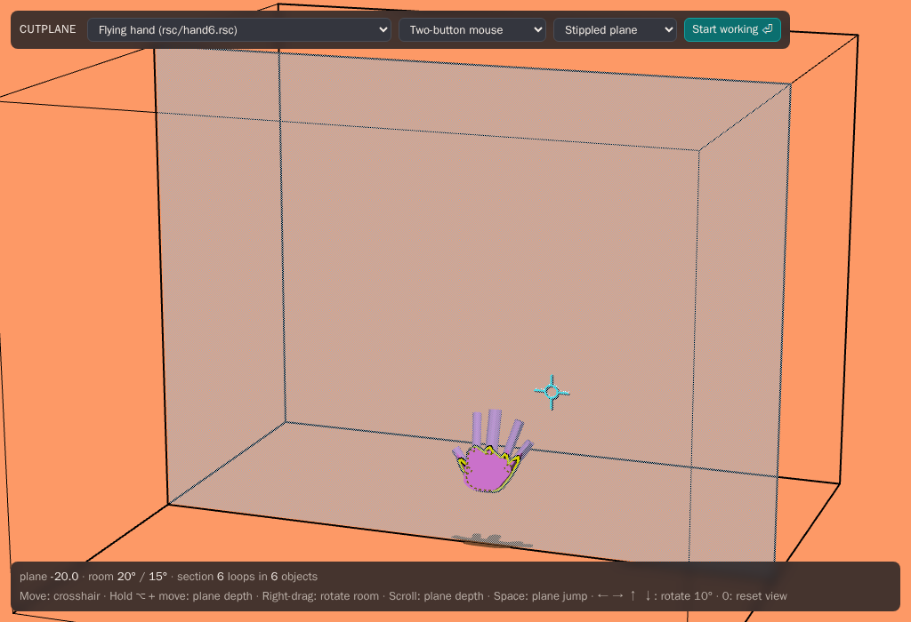

## Differences from the original

Cutplane follows what the 1990s 3Form actually did, read from its C and CPL sources rather than
the papers. Where it differs, it's on purpose, and the differences are listed here.

**New things**

- **Undo and redo** (⌘Z / ⇧⌘Z). The original's U key did nothing.
- **The plane sticks to parallel faces**, switched on from the original's unused `do_sticking`,
  with its distance chosen in the top bar (see the plane's stops above).
- **Broken drags are put back.** A drag that would leave a solid broken (an edge squashed to
  nothing, a face folded flat) is undone on release, and a delete that would do the same is
  refused. The original let both happen.
- **Group drags.** Pressing on something already picked keeps the other picks, so several things
  can be dragged together. `assets/cpl/rom.cpl` is `rom.cpl` with this change made (marked
  "cutplane_web"), as the lines its authors had commented out were meant to do.
- **The plane jump glides, and alternates walls.** Space sends the plane to the back wall and
  back, then to the front wall and back (the original only had the back wall), over a quarter
  second, eased, instead of in one frame, so the room doesn't jump under you. Whatever is picked
  or held still travels with it. `assets/cpl/cursor.cpl` is `cursor.cpl` with this change
  (marked "cutplane_web"): `Jumplane` works out the jump, and a new `Glideplane` message moves
  each frame's share. These two, and the tools' own pads (below), are the only changes to the
  original's CPL (the union tool's `union.cpl` is new); every other script runs as it was.
- **Code in files, edited live.** Objects carry their CPL inline in `.cut` files. The original
  saved only the name of a code file, and only for vertices, edges and faces. The CPL editor is
  new, and so are Save and Open outside the Load/Save plate.
- **Broken imports still pick.** An object whose section doesn't close (an import that isn't a
  solid even after its holes are closed) is picked whole from inside any of its section loops,
  an open one closed straight across. A solid's section always closes, so nothing else changes.
- **Mesh files, drag and drop, autosave.** The original read and wrote only its own `.cut`
  format. Cutplane also adds OBJ, STL and glTF models to a world, exports to them, takes files
  dropped on the page, and keeps every change in the browser as it's made.
- **The room as you left it.** The original always started afresh, facing the room straight on.
  Cutplane keeps the session (the plane, the view and every tool and goodie where it was left)
  and opens the first visit turned a little, with the keys plate open.
- **The pencil tidies its stroke.** Steps too small to see and points along straight runs are
  merged before the stroke is closed. A stroke that crosses itself becomes the largest region it
  encloses, and one that closes on less than 25 square units is thrown away. The original kept
  every point and only refused a stroke that wasn't flat, so a scribble could make a broken
  solid.
- **The saw parts a group's halves.** In `slice.cpl` each half's 10-unit move goes to the whole
  group a part belongs to, so the two moves cancelled and a grouped part's halves stayed
  together. A later Cutplane moved them apart; here `slice_object` moves a grouped part's
  pieces itself.
- **The saw cuts what is picked.** The original's saw cut only what was under it, and taking it
  (like any click on a pad) unpicked everything, so a group was cut one part at a time. Here a
  click on a pad, plate or tool leaves the pick alone, and the saw on something picked cuts
  everything picked, groups whole.
- **Faces can extrude.** The original only stretched a dragged face. A toolbar choice makes a
  face pulled outward grow walls of its own instead (_Faces extrude_), at the cost of the extra
  edges the SGI could not afford.
- **A click on nothing doesn't jam a tool.** On a click with a tool that hit nothing,
  `tool.cpl` sent the tool a `Fliptool` message, which only the pencil's eraser read; every other
  tool (the saw) kept it at the head of its queue and stopped reading its own messages, so it
  never worked again. The original's comment wonders where tools' "bogus messages" come from:
  this was it. The message is no longer sent.
- **Gravity, and groups picked whole.** New: the globe drops things to the floor, and a toolbar
  choice picks a group whole from any of its parts. The globe's picture is the Earth, from
  Natural Earth's coastlines. A double click with it keeps gravity on, and what is dragged
  dangles.
- **The group tool works in hand.** In the original, `group.cpl` took only an Activate message,
  sent by G or by a push-button pad, but `arrangepads.rsc` put the tool on an ordinary pad, so
  taken from its pad it did nothing. Here a click with it on what is picked groups or ungroups,
  and a marquee with it groups what it touches (`assets/cpl/group.cpl`; `tool.cpl` lets its
  presses through, as the ruler's; `cursor.cpl` asks `touching_marquee` for the set).
- **The magnet shows its snap.** The original's magnet snapped on release to whatever face was
  under the crosshair, unseen until then. Here, taken by a face, the face it would snap to is
  highlighted as the drag goes, and a see-through ghost of what is dragged shows it snapped there.
  What is dragged stays on the crosshair (through anything); the release takes it to the ghost.
  The magnet stays in hand after a snap, and takes something already picked at the first press
  (the original's press picked it again, then unpicked it). `assets/cpl/magnetic.cpl` is
  `magnetic.cpl` with these changes made (marked "cutplane_web").
- **Falls can be interrupted.** A press stops what is falling where it is, to be picked; what
  isn't picked falls on.
- **The keys plate.** New: the ? pad or key opens a plate of the keys and tools at the plane's
  side, in groups, in place of a flat status bar.
- **A new hand.** The pan tool's picture, drawn in 1991, was an outline that doubled back on
  itself, its sides joining its front to its back at the wrong points, so it shaded in broken
  pieces. It is drawn again (`assets/icons/pan.icon`, made by `docker/hand/make.mjs`): one
  smooth outline, its edges rounded, as pink as before, with a cuff at the wrist.
- **Tools are one size in hand.** The original's tools ran from the globe's 50 units to the
  pencil's, saw's and drill's 150, so some were huge in hand and others tiny. Here none is more
  than 60 across (`TOOL_MOST`, `toolbar.ts`'s `fitInHand`, as each is read): the pencil, saw,
  drill, magnifier, magnet, grabber, union, group tool and ruler are scaled down to it, about
  their corner (where a tool sits on the crosshair is its hotspot, wherever that is). Their
  pictures on the pads are as they were. The drill's cutter is a copy of what it's pressed
  on, so its holes are as big as ever.
- **Double clicks.** The original counted them (`controls.c`'s `Doubleclick`) but nothing used
  them. Here: with the magnifier, fit everything into the room; with the globe, gravity always;
  on the colour control's base or the camera's body, back into the goodies box (as dropping it
  on the box does).
- **The 1 key** draws what isn't picked as grey wire, or puts it out of sight; with nothing
  picked, everything as wire. The original drew hidden edges only while the plane or room moved.
- **Far edges are dimmer.** A highlighted edge whose faces are all turned away is drawn at about
  half brightness.
- **A union tool, and B unions.** The 1991 rails had no union tool (a later Cutplane did, with
  the two green blocks as its picture); its `B` key (`BOOLEANBUTTON`, a test hook) subtracted
  the second picked object from the first. Here the green blocks are the union tool, on the
  tools' rail (`assets/cpl/union.cpl`, after `drill.cpl`), and `B` unions everything picked. The
  grabber has a new picture, a claw, and the arranging rail's headpad three bars in a row. The rails are `assets/rsc/toolpads.rsc` and `arrangepads.rsc`, the new
  pictures in `assets/icons/`.
- **H is the pan tool, P the pencil, M the ruler.** The original's P brought the pan tool.
- **⌘A picks everything** (as `cursor.cpl`'s marquee release does, over the whole world).
- **A help pad.** The ? pad opens the keys plate, a Dialog as the storage pad is
  (`behaviors/src/tools/help.ts`). The original had none.
- **The measure pad comes with a ruler.** The original's pad (`create_measure_pad`, with
  `measurepad.cpl`, `cubeplate.cpl`, `distanceplate.cpl`, `sizer.cpl` and `namer.cpl`) was always
  there, and a click on it opened or shut all its plates at once. Here it comes out with the
  ruler, a new tool (`assets/icons/ruler.icon`, its `Measure` property letting picks through in
  `assets/cpl/tool.cpl`), which isn't drawn on the crosshair, and the pad takes no clicks.
  Further:
  - every object is measured, by its box. The original measured only primitives that carried a
    record, though `generate_info_rec` already fell back on the box (`assets/cpl/rom.cpl` sends
    every pick; `assets/cpl/measurepad.cpl` asks the new `measure_info_rec`);
  - a new size scales the object in place, its parts and links kept; `remake_prim` rebuilt
    cubes only, as a new object;
  - two whole objects get their full distance, centre to centre, and any two features their
    vector; the original gave objects zero and most pairs only a length. Typing moves the second
    pick; the original's `set_feature_dist` moved the first;
  - marquees are measured while they're dragged.
- **Typing replaces a field's text.** `textinput.cpl` marked a just-clicked field and had the
  lines to clear it commented out; `assets/cpl/textinput.cpl` clears it on the first key (or
  Backspace), and an arrow first edits it in place. The text to be replaced is outlined, and
  the I-beam is drawn three strokes thick.
- **The pencil draws on surfaces, from the later `draw.cpl`.** `cplpropfiles.rsc` loaded
  `pencil.cpl`; `draw.cpl`, a later pencil, adds drawing across a face (`draw_on_surface`) and a
  flip to the eraser. `assets/cpl/pencil.cpl` is `pencil.cpl` with the surface drawing added;
  the eraser is left out, and pressed on a face or an object the pencil scribbles, where
  `draw.cpl` did nothing. The original broke the first edge even when the line couldn't be
  drawn; here nothing changes unless it is.
- **Each tool goes back to its own pad.** In the original, clicking a pad while holding a tool
  swapped the held tool onto that pad, and a tool put away after use (or by a key) went to the
  first empty pad, so tools wandered from pad to pad. Here `toolpad.cpl` connects a tool to the
  pad that gives it out (`CONNECT`, an empty stub in the original, now does what its comment
  says) and takes back only its own; `tool.cpl` puts a tool away on its own pad
  (`assets/cpl/tool.cpl`, `toolpad.cpl`, marked "cutplane_web").
- **Tools in hand are bigger, and alike in size.** `tool.cpl`'s `Activate_tool` scales a tool
  up as the crosshair takes it (the new `tool_to_hand`: a long, thin tool to 120 long, any other
  to 75 across) and `Put_away_tool` scales it back (`tool_to_pad`). **Esc** puts it away too (the original had
  no key for that but the tool's own).
- **A drill click does nothing.** Pressed and let go on one object, the drill's cutter is an
  exact copy of it, and `CPBOOLEAN` took the whole object away. A subtraction that would leave
  nothing now leaves the object as it was.
- **Decals sit on their pads.** The original stood each pad's picture `Decalzoffset` (28) off
  the pad, which only ever showed head on. Here it stands 1 off, so with the room turned the
  pictures stay on their pads.
- **Booleans and slicing go through manifold-3d.** The original's own boolean (`boolean.c`)
  handled only an object's first shell and had known bugs. Here both operands become triangles
  tagged by face, manifold-3d does the operation, and the result comes back as the original's
  kind of polygon faces, holes included: faces from one face are joined again, coplanar faces of
  the two objects merge, and vertices are exact (an input vertex keeps its position; a new one is
  solved on the planes of its faces). An operation whose result wouldn't be a sound closed solid
  is refused and changes nothing.
- **Trackpads and two-button mice.** The SGI had a three-button mouse (middle drags the
  plane, right turns the room). That layout still works, and so do ⌥ / ⌘ quasimodes for
  trackpads and two-button mice, all at once with nothing to set.
- **Windowed mode.** Besides full-screen work mode, which captures the pointer the way the SGI
  did, the app runs in a browser window with the crosshair following the hidden pointer.

**Fixes to the original's behaviour**

- **Picking.** Any vertex on the plane counts as a vertex. The original only counted one with
  an edge lying in the plane, through a pointer comparison in `cursor_near_pt`. Only the single
  best pick across all objects is taken, where the original picked one per object under the
  crosshair.
- **Rotate tool.**
  - The face snap's 7.5° limit on a single move now tests the size of the angle. The original
    let every negative angle through.
  - The dial keeps fractional degrees. The original rounded each mouse event down to whole
    degrees, so slow turns were lost.
  - **R** over a vertex, or over a face lying in the plane, brings the tool there. The original
    left it where it was.
- **Scale boxes** keep every side at least 1 unit long. The original could scale a solid flat or
  turn it inside out.
- **Faces in the plane can be scaled.** The original gave only a whole object a scale box; a
  face could be dragged but not resized, so a truncated cone had to be sliced off a cone of the
  slant wanted. Faces picked in the plane now get a flat box whose corners scale them.
- **Colour bars** all map their height to 0–255 the same way. In the original, the bar being
  dragged used a different formula and could go past 255.
- **Toolboxes, pads and plates.** The storage pad starts in the plane, bottom left. The
  original left it by the back wall, and only a drag brought it into the plane. A plate's offset
  is taken from its pad, so a plate with no depth offset lies on its pad, not in the plane
  (where it flickered against the plane's stipple). Headpad pictures keep a margin inside the
  pad.
- **A face's "mother edge".** `find_largergrain(face, edge)` returned an unset pointer, and
  `rom.cpl`'s test for an edge pick relied on getting something other than the face back; here
  it is the face's first edge.
- **The camera's view** is on a screen in the room above the camera, not in a second window as
  the original's was ("Camera's View"): a browser's second window got lost behind the first,
  and there's no room for one on a laptop. The **light bulb** adds a point light in its colour to the face shading, as
  `setup_light_source(2, ...)` did.
- **Saving through the Load/Save plate** keeps the world in the browser, under the typed name,
  and loading looks there first, then among the bundled samples. The model menu lists what is
  kept. The original read and wrote
  files in its working directory.
- **Property code runs in the original's order.** A feature's properties are read as
  `read_feature_props` read them, each added to the front of its list, so the saw's `Slice`
  code sees a click before its `Tool` code takes it. (In M5 the list was kept in file order,
  which let `tool.cpl` swallow every tool's click.)
- **Property files load when they're needed**, as `read_CPL_propfile` did: the grabber's,
  magnet's and pan tool's code comes with the tool, not at startup.
- **Zooming is undoable.** The magnifier scales the world's objects, as `zoom_world` did, so undo
  takes a zoom back like any other change.
- **Sections** always come out as closed loops, even through nearly flat faces that 1991 float32
  drift left slightly bent. The original warned "face crosses plane odd number of times" there.

**Timing.** Ctrl's axis decision is measured by distance (5 units), since browsers send many
more, smaller events than the SGI did. The rotate tool's brief stops (at perpendicular, and the
dial at horizontal) are the original CPL's counters again. The app sends CPL one coalesced move
per frame, so they count frames, as the original counted its update loop.

**Geometry.** Every coordinate snaps to a 1/256-unit grid, so repeated rotations can't build
up error and coincident points are exactly equal. The original used floats. Files written by
older versions of the format are normalised to the latest one on save.

**Left out on purpose**

- **No 15° rotation steps.** The plan promised 15° and 5° snapping, but `Rotatesnapangle 15` is
  a dead constant in the original and Ctrl does nothing to rotation. The only snaps are the face
  magnet and the two stops above.
- **Code the original never ran isn't ported:**
  - the z-pause while constraining (only `do_cursor_notifications` sent it, and nothing calls
    that);
  - `recombine_affected_coplanar_fves`;
  - `duplicate.cpl`, `delete.cpl`, `colorctrl.cpl`, `sizebbox.cpl` and the `old*` rotate
    scripts (those, `calipers.cpl`, `menu.cpl`, `toolbar.cpl` and `workgroup.cpl` are in an
    older CPL dialect that doesn't assemble).
- **Not yet:** the pencil's eraser (`draw.cpl`'s flip, `erase.cpl`) and the pie chart plate.

## Shipping (M8)

- **The site** is the static build on GitHub Pages (`.github/workflows/pages.yml`), rebuilt on
  every push to `main`. The Render and Railway configs stay in the repo, unused for now.
- **Help, measure and text:** `behaviors/src/tools/help.ts` (the ? pad: a Dialog whose plate
  is the keys plate, built in code from `keyLines` in `app/src/input/bindings.ts`), `tools/measure.ts` (the measure
  pad, its plates from the original resources, and the C routines its CPL calls; a frame hook
  shows it while the ruler is held), and `clear_label` for `textinput.cpl`.
- **Kernel:** `ops/split.ts` (`splitEdge`, `drawAcrossFace`) for the pencil on a surface;
  `Brep.fingerprint()` (a hash of every array and map) lets the renderer and the `.cut` writer
  keep what they made for a B-rep that hasn't changed; `facesByShell` / `verticesByShell` replace
  per-shell scans (a model of many shells cost shells × faces).
- **Speed:** a click on a 6,000-face import takes 3 to 25 ms (it took up to 200 ms in Firefox and
  WebKit): an object only told it changed keeps its meshes, one only moved has them shifted,
  sections are kept per geometry, and autosave rewrites only changed objects.
- **Screenshots:** `docker compose run --rm -e GUIDE=1 e2e` retakes the user guide's
  (`e2e/guide.record.spec.ts`); `-e RECORD=1` records the README animation.

## Formats (M7)

- **`packages/formats/src/mesh`** holds the mesh formats: plain TypeScript, no DOM.
  - **Out:** `faces.ts` turns each face into room-space loops and triangles (earcut, holes cut
    out, wound with the face). `writeObj`, `writeStl` and `writeGlb` (built with
    `@gltf-transform/core`) write from those.
  - **In:** `readObj`, `readStl` (binary or ASCII, Z up turned to the room's Y up) and `readGltf` (.glb, or .gltf with its
    buffers) hand `polygonize` a mesh. It welds equal positions, joins neighbours that lie in one
    plane (normals within about 0.06°) and share a colour, and chains each group's boundary into
    an outer loop and holes. A boundary that pinches leaves its triangles as they were. Each
    connected piece becomes a shell; the commonest colour is the object's, the rest are painted
    on faces.
  - **glTF placement:** a node whose world matrix is a rotation (times a uniform scale) keeps it
    as the object's xform; a sheared or mirrored one is baked into the positions. Nodes are
    written at their object's origin, unturned, under their parent.
  - **Faces through glTF:** each vertex carries `_FACE`, its face's number (glTF allows
    application attributes with a leading underscore). Reading a Cutplane GLB joins triangles by
    it rather than by plane, so the 1991 models' slightly bent faces come back whole.
  - **Not solids:** `stitch` puts each boundary vertex that lies on an open edge (within 10⁻⁵
    of the model's size) into that edge; `closeHoles` chains the open edges left into loops,
    pinches split off, and caps each: one face if flat, earcut's triangles if it flattens
    without overlapping itself, else a fan from a new point at its middle. `holesClosed` counts
    them per object.
  - **Texture colours:** `readGltf` takes a `decodeImage` (the app's uses `createImageBitmap`
    and a canvas; formats has no codecs) and samples the base colour texture at each triangle's
    middle UV, with repeat wrapping, in linear light, rounded to steps of 8.
  - **`fitToRoom`** scales and centres imports that don't fit or are tiny, then snaps vertices to
    the 1/256 grid, as every committed vertex is.
- **The app:** `ui/files.ts` sorts files by extension, reads models (a file of several parts
  under a grouper) and exports. `Runtime.addObjects` makes an import one undoable step. The
  journal counts edits (`edits`); the app autosaves once the mouse and keys have been still for 5 s
  after it changes (writing a big world out takes a moment), and at once when the page is
  hidden.
- **Undo history in the autosave** (`behaviors/src/history.ts`): objects are numbered (the
  root, the world's objects in .cut order, then "ghosts" the history still holds, deleted ones),
  each snapshot is a one-object .cut text (written once and cached), and tree snapshots are
  number triples. The world and history go in IndexedDB (`ui/idb.ts`); localStorage keeps the
  menu's title and time, and the world alone if IndexedDB can't be had. A history that doesn't
  fit the world it's loaded with is dropped whole. It keeps at most 16 MB of
  snapshot text (`HISTORY_BUDGET`), the newest steps that fit: each move of the Mars rover was
  two copies of it, 67 MB, written out again on every autosave (and still there after it was
  deleted, in the steps that bring it back), which froze the page for seconds after each edit.
  One far over that (kept before the budget) isn't read back at all.
- **Old formats** (`mesh/inventor.ts`, `mesh/dxf.ts`): one parser for Inventor ASCII and both
  VRMLs (a node is `[DEF n] Type { fields children }`; field values are numbers, words, strings
  or nodes), in one pass over the text, numbers read straight into `Float64Array`s. Binary
  Inventor (`mesh/inventorbin.ts`) is read into the same nodes: big-endian words, strings as a
  length and padded bytes, each node its type, a flags word (V2.1), a field count, each field
  its name, value and flags, then a group's children. Built-in nodes don't say their fields'
  types, so `mesh/inventorfields.ts` does, for Coin3D's 160 Inventor nodes;
  `docker/coin/make.sh` remakes it, and the binary test files, with Coin in Docker. The nodes are
  walked with Inventor's traversal state (matrix, coordinates,
  materials and binding, vertex ordering) and VRML 2.0's Shape/Transform nesting. Positions are
  baked into the room. DXF is read as group-code pairs, anything before the first SECTION (a
  1993 mail header) skipped, layer colours from the LAYER table, BYLAYER and BYBLOCK followed.
  Faces with no stated winding (Inventor's default, all of DXF) are turned to agree with their
  neighbours and then outward (`orient` in `polygonize.ts`). A face set takes only the points
  its faces use (face sets often share one list of tens of thousands).
- **Big files:** `ui/importer.ts` reads in a worker (`ui/import.worker.ts`), which hands back the
  objects as plain data (`ui/packing.ts`, `Brep.data()`), their B-reps' arrays transferred, not
  copied. `polygonize` and `buildShell` key edges by vertex pairs in a `PairMap` (flat typed
  arrays: millions of edges without an object, or a boxed number, each). The Mars rover (58 MB,
  5,300 face sets) reads in about 3 s; before, it took 113 s and 10 GB, and the page froze. The
  plane's stops (every vertex depth) are taken again only when the world's models change, not on
  every redraw. `render/loadingring.ts` is the ring: drawn last on a cleared depth buffer, so it
  shows over everything, lit by a light fixed to the eye.
- **Gravity:** the globe is a tool like the saw (`assets/icons/globe.icon`, its `Gravity`
  property's code in `assets/cpl/gravity.cpl`), and its new C routine `drop_objects` hands the
  groups clicked on to the app (`Runtime.dropper`). `app/src/world/gravity.ts` makes each group
  one rigid body, a convex hull per part (a flat part gets a thin box), in
  [Rapier](https://rapier.rs) (`@dimforge/rapier3d-compat`, a physics engine compiled to
  WebAssembly: a chunk of its own, 1.6 MB compressed, loaded only when something first falls). The floor is a slab under
  the room, out past its walls; the other objects under the fall (those within a falling one's
  width of it) stand still as triangle meshes, their triangles as drawn (`ModelView.triangles`),
  so things land on them as they look. The whole fall is worked out first (120 steps a second, until everything has
  been still for a quarter of a second, at most 8 s), then played back by the clock: the meshes
  are only moved (`ModelView.pose`, the shadow being the mesh squashed onto the floor), and the
  world changes once, where the fall ends, as one undo. Landings are made soft (restitution 0.1,
  angular damping 8): a rigid drop from the room's height onto one corner flipped a four-legged
  test body onto its back. The Mars rover, held up and tilted 20° or 35°, comes to rest on its
  wheels within 0.7° of level, worked out in 100 to 300 ms. `docker/globe/make.mjs` makes the
  globe's picture: 1,152 faces of sea, land and ice from Natural Earth's 1:110m land.
- **Gravity always** (a double click with the globe; `main.ts`'s `gravityTick`): after every
  edit that wasn't an undo, a redo or a landing, the whole world is dropped quietly
  (`Falls.drop(..., { quietly: true })`): what wouldn't move stays as it is, picked or not, and
  only what falls is put out of reach. A landing that leaves a thing where it was isn't an edit.
  **Dangling** (`world/dangle.ts`): the object held is a rigid pendulum, its weight spread over
  its faces (each face's area at its middle), turning about the point held, or only about the
  edge held (a hinge), under gravity and the crosshair's acceleration, damped, integrated four
  steps a frame. The click's vertex, edge, face or inside comes from `Runtime.wholePicks`, kept
  as a click is collapsed to the whole object (`Runtime.dangling` makes every object pick whole).
- **The magnet's ghost** (`world/magnet.ts`): a press with the magnet tells it what it took
  (`Magnet.grab`): a face, and the point taken on it (the Selectable's point, kept in the
  object's own coordinates). Each frame of the drag, `Runtime.faceUnder` runs the picking
  (`pickAt`, the pick size) on every object but the dragged group's, keeping face picks, and
  `Runtime.faceSnap` gives the world move that turns the face taken about the point taken to
  face that one and carries the point onto the one picked. The highlights draw that face as the
  hover, and the dragged parts' meshes (shared, 15% opaque) and edges moved by it
  (`HighlightState.ghost`). The release
  applies the move (`Magnet.release`, before CPL's release): `magnetic.cpl` snaps only when a
  face is selectable under the crosshair at release, and there the dragged object, picked whole,
  is. `Runtime.magnetSnap` then tells `snapFeatures` the release has been seen to. An edge taken
  snaps on release as in the original.
- **Catching a fall** (`Falls.catchAll`): a press (not with the globe) ends every fall under way
  at the frame it has got to, as one edit, before the pick. Each fall's motion there is read off
  its recorded poses (`motionAt`: its box's middle from one frame to the next, and the turn
  between them, as an axis and angle a second). After the pick (once no CPL message waits), the
  groups not picked are dropped again with that motion (`Dropped.motion`: Rapier's linear and
  angular velocity).
- **The keys plate** (`installHelpPad`, `showKeysPlate` in `behaviors/src/tools/help.ts`;
  `keyLines` in `bindings.ts`): a plate, as `read_plate` makes them, the help pad's Dialog plate,
  set off from the pad to sit at the plane's right, two Hershey labels a line (one for a
  heading). The ? key shows it or puts it away directly, as the pad's click would. There is no
  status bar: an import's notices go to the console.
- **The hand** (`docker/hand/make.mjs`): a signed distance field of a palm, four finger
  capsules and a thumb, smoothly unioned; traced by marching squares, spaced evenly round (240
  points), and extruded through rings inset along each point's inward normal so both edges
  round over (quads up the straight side, triangles where it rounds, so every face is flat).
  The hotspot is the middle fingertip, as the original's. It is about 55 high. The cuff, made
  the same way, is its child, a little thicker: `tool.cpl`'s `Put_away_tool` turns a tool
  with no children end for end on its way back to its pad, and `Flip_tool`, finding no other
  end, hands back the tool's parent instead, so a one-piece hand never got home (the
  original's was three pieces).
- **The 1 key** (`ModelView.setStyle`): a mesh drawn as wire draws nothing itself and carries
  its wire as a child (so it moves, and falls, with it): each face's edges with the face's
  normal, the faces turned away left out in the shader for the front-only view. What is out of
  sight is in `Runtime.unseen`: not drawn, cut, highlighted or picked.
- **Tests:** `formats/test/oldformats.test.ts` reads Inventor, VRML 1.0 and 2.0 and DXF written
  for the tests, and (locally, from the archive) `robot2.dxf`, a 1993 robot arm David Lees mailed
  Larry: 52 layers, each a solid. `formats/test/mesh.test.ts` round-trips a cube, a holed face and five samples
  through each format. It checks points (within the grid), volume (within 10⁻⁴), face counts
  (the same through glTF, never more through OBJ except holed bent faces), colours and nesting.
  It reads glTF turned, scaled and sheared by other tools, runs the Khronos validator on a
  GLB, closes a lidless box and a sheet, stitches T-junctions, and colours triangles from a
  texture. `behaviors/test/history.test.ts` saves an edited world's history, loads it into a
  fresh runtime, and checks every undo and redo gives the same world. `e2e/files.spec.ts` drops an STL, exports and re-opens a GLB, downloads OBJ and STL,
  reloads into an autosave and undoes and redoes there, imports open textured parts as a
  coloured group, and refuses a broken file.
- **Blender:** the Discovery, stapler and floor fan GLBs open in Blender 4.3.2 (headless, in
  Docker). The Discovery is 34 meshes under 3 group empties, with 6 materials.

## Modeling operations (M6)

- **`packages/booleans`** is the adapter to manifold-3d (WebAssembly, loaded at startup):
  - Each face is triangulated (holes included) and tagged with its face, in the room's frame.
  - After the operation, triangles are grouped by the face they came from, split into pieces
    joined across shared edges. Each group's boundary is chained into loops: the outer loop winds
    with the face and holes go inside it. Vertices left in the middle of a straight edge are
    dropped.
  - manifold's mesh is single precision, so positions are rebuilt: an input vertex found again
    within 10⁻⁴ keeps its exact position (in the first operand's own frame), and a new vertex is
    solved in double precision on the planes of the faces around it.
  - Every result shell is built and validated; anything not closed and sound (a degenerate face,
    a zero-length edge, a bent face, a non-manifold vertex) refuses the whole operation.
  - Results are grouped into solids: each outward shell with the voids inside it.
- **Property test.** 10,000 random chains of 2–6 unions, subtractions, intersections and slices
  on cubes, cylinders, cones, pyramids and spheres, square to the room or at any angle, give no
  corrupt model (`BOOL_CHAINS=10000`; CI runs 300). Two seeds: 31,338 and 31,320 operations,
  54 and 47 of them refused (0.2%), every other result a sound solid.
- **`packages/behaviors/src/modeling.ts`** is `do_boolean` and `slice_object` on objects:
  `CPBOOLEAN` and `Crtn:slice_object` for the drill's and saw's scripts, and the `\` key. A
  boolean leaves A as the result and B gone, as the C did. `tools/pencil.ts` is `start_draw`,
  `extend_draw` and `end_draw`; `do_zoom` scales the world about the crosshair.
- **The tools run on their original scripts** (`slice.cpl`, `drill.cpl`, `pencil.cpl`,
  `magnetic.cpl`, `grabber.cpl`, `pan.cpl`, `zoom.cpl`, `group.cpl`), each tested off its pad.

## CPL and the environment (M5)

- **`packages/cpl`** is the language. The assembler reads the original `.cpl` files as they are,
  and the VM follows `cplcore.c` and `cplops.c` closely:
  - tagged words in one flat memory, with the original's addressing (`A:`, `AA:`, `*`, `&`);
  - the resolver iterates feature lists like an odometer;
  - JSRAT, per-feature message queues, and updates logged during a frame and done at its end;
  - property lists kept per world, as the original's were.
    The disassembler and trace drive the tests. Each known bug in the original VM is fixed only
    behind an option (`fixes`), so the original scripts run as they always did.
- **`packages/behaviors`** is the world the VM runs in: the C side of the original, on the
  kernel.
  - `Runtime` implements the host API the opcodes call (picking, translation, adoption,
    duplicates, deletes, colours, labels, worlds) and select.c's selectechniques.
  - `Controls` turns input into RAM sentences as `controls.c` did: PICK, RELEAS, TRANS of the
    crosshair and of what is picked, key commands as messages, and typed characters for text
    inputs.
  - Each tool in `src/tools/` builds its objects the way `tools.c`, `rotatetool.c` or `scale.c`
    did and ports the C routines (`Crtn:`) its scripts call. The tools are the rotate tool, scale
    boxes, colour control, toolbars, toolboxes, goodies and plates.
  - Undo is a journal of the edited world. Scale boxes come and go with picking, so they are
    never recorded.
- **The app** sends each frame's motion to CPL and draws what the VM says: highlights from
  Selectable and Picked, the tools from Visible and Active, pads, decals, Hershey labels and
  plates.
- **Tests** run the original scripts end to end: picking, dragging, marquee, delete, duplicate,
  plane jump, every tool, stamping, the pads and the plates. Further tests cover live edits
  of `stamp.cpl` and an object's code surviving a save and a reload.

## Tools (M4)

Ported from `rotatetool.c`, `rotateobj.c`, `scale.c`, `duplicate.c`, `topology.c`'s
`delete_vertex` family and `tools.c`'s `create_color_control`, and the CPL that drove them
(`rotatecircle.cpl`, `rotatexbar.cpl`, `rotatebauble.cpl`, `scalebbox.cpl`, `colorbar.cpl`,
`paint.cpl`, `rom.cpl`).

- **No 15° steps.** The plan promised 15° and 5° snapping, but `Rotatesnapangle 15` is a dead
  constant in the original and Ctrl does nothing to rotation. Its only snaps are the ones above:
  the 5° magnet that lays a face into the plane, the stop at perpendicular, and the dial's stop
  at horizontal.
- **Deliberate fixes** are listed under
  [Differences from the original](#differences-from-the-original).
- **Goodies.** The colour control's base runs `goodies.cpl`, which every goodie runs: picked, it
  drags the whole control. In M5 it moved into the goodies box, out of which it is dragged.
- **Kernel.** `ops/delete.ts` follows `delete_vertex`: every face around the vertex is first cut
  so only a triangle touches it, then the triangles merge into one face across the neighbours,
  which is triangulated if bent. Earlier deletes can leave a vertex where two fans of faces meet;
  deleting one of those is refused. A property test runs random chains of deletes on a cube, a
  holed cube and a sphere and checks the B-rep stays consistent.

## Direct manipulation (M3)

The behaviour comes from the original's CPL scripts (`cpl/rom.cpl`, `cpl/cursor.cpl`) and the C
they ran on (`select.c`, `translate.c`, `split.c`, `update.c`), not from the 1988 paper or the
2017 JS port. Both of those moved faces along their normals; 3Form translates them in the plane.

- **Picking** (`packages/kernel/src/select/pick.ts`) uses the original's square pick box
  (`Pkboxsize`, 10 units) and priority order.
- **Planarize** (`packages/kernel/src/ops/planarize.ts`) runs before every step of a drag, as
  `planarize_affected_fves` did. Pieces of a face share a surface (`mothersurf`). On release they
  merge back if they are as flat as the face they came from, so slightly bent float32-era faces
  in old files merge back too. Faces that were separate to begin with never merge.
- **Departures** from the original (picking changes, Ctrl measured by distance, undo, rollback,
  group drags, and the code it never ran) are listed under
  [Differences from the original](#differences-from-the-original).
- **Tests.** A property test drags random vertices, edges and faces of a cube and a cube with a
  hole and checks that the solid stays closed, consistent and flat, before and after recombining.

## Sections (M2)

- **Algorithm.** `packages/kernel/src/section/section.ts` rewrites the original's `intersect.c`,
  which made per-face segments but never chained them into loops. Each vertex is classified once
  as in front of, behind or on the plane. On-plane vertices count as "just in front" (a symbolic
  perturbation), so every edge either crosses or doesn't, and the degenerate cases (a corner
  touching the plane, an edge or a whole face lying in it) are limits of the generic one. Each
  crossing is keyed by its edge, which both of the edge's faces share, so segments chain into
  loops by edge ID alone, with no point matching and no epsilon. Loops run counter-clockwise
  around material and clockwise around holes, and each segment records its face and edges, for
  selection in M3.
- **Tested on real models.** Every closed shell in the bundled samples, the original resources
  and the 1991–94 archive gives only closed loops, cut at 15 depths and exactly at sampled vertex
  depths. That includes nearly flat faces left slightly non-planar by 1991 float32 drift, the case
  the original warned about ("face crosses plane odd number of times").
- **Rendering** follows `grafx.c`: the SGI's 50% polygon stipple for the plane (one cell per CSS
  pixel), `shade.c`'s ambient light plus two lights fixed to the room, the plus-shaped 3Form
  crosshair (`cursor.c`), and the room's black edges over background-coloured halos. Colours are
  the original 8-bit values, written to the screen unconverted.

## Geometry kernel and files (M1)

- **B-rep.** `packages/kernel` is a half-edge boundary representation after Mäntylä's GWB, the
  same model as the original's `topology.h`, stored in typed-array pools with stable integer IDs.
  All nine Euler operators are implemented (mvfs, mev, kev, mef, kef, kemr, mekr, kfmrh, mfkrh),
  plus sweep, revolve, apex split and the original's primitives. The chair and table come later,
  since they're multi-object groups.
- **Coordinates.** As in the original, vertices are stored in object-local coordinates alongside
  the object's transform. Every coordinate is snapped to a 1/256-unit grid, so repeated rotations
  can't accumulate error and coincident points are exactly equal.
- **Validation.** `validate()` separates structural errors (broken links, which must never
  happen) from manifold and geometry warnings (open or misoriented edges, non-manifold vertices,
  zero-area or non-planar faces). Old files and laminas can legitimately have warnings.
- **`.cut` files.** `packages/formats` reads and writes the Sequoia format line for line. It
  tolerates the archive's variants: missing technique lines, missing end markers, a missing
  Motherworld line, a Zoom Scale line, a file with 0-based vertex indices, and so on. Each
  coordinate is written as the shortest decimal that snaps back to the same value, so files the
  original wrote come back byte for byte.
- **Results on Larry's 1991–94 archive (116 files, 2,015 objects).** Every file loads, passes
  structural validation and round-trips. 89 files rewrite byte-identically. The other 27 differ
  only because they were written by older format versions, which are normalized on save. 1,560
  of the objects are closed manifolds. All 31 `.cut`-format resources in `assets/original` pass
  too.

## Development notes

- **Builds run in Docker only.** `compose.yaml` keeps every `node_modules` in named volumes, so
  the Linux binaries never land on the host.
- **Firefox E2E runs headed under `xvfb-run`.** Headless Firefox on Linux has no WebGL.
- `pnpm check` is the full local gate. (pnpm 12 reserves `pnpm ci` for a clean install.)
- **Archive corpus.** The full archive isn't in the repo. Put it in `corpus/cut/` (git-ignored)
  or set `CUTPLANE_CORPUS`, and the corpus tests run too; CI tests the bundled samples and
  original resources. `node packages/formats/scripts/report.ts c
